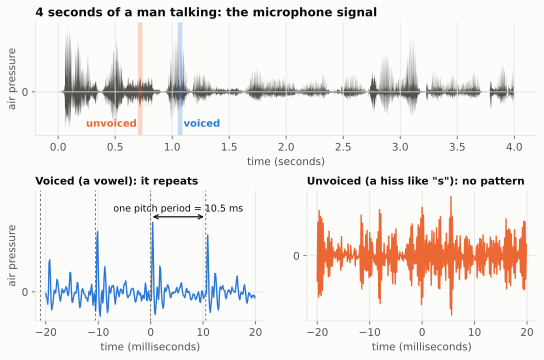
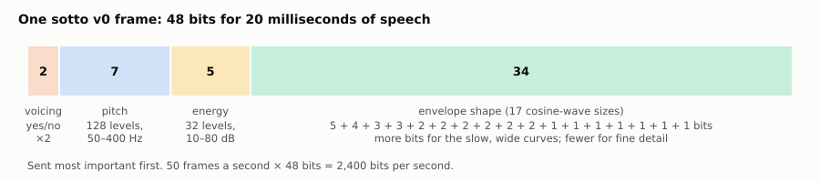

# 1. Sound, numbers and the 2,400-bit budget

[Course home](README.md) · Next: [Pitch and voicing](02-pitch-and-voicing.md)

## Big idea

A microphone turns your voice into a long list of numbers. That list is far too big to send over a small radio channel. A **vocoder** doesn't send the sound. It sends a short *description* of how you're making the sound, and the receiver rebuilds a voice from the description.

## Sound is air pressure that wiggles

When you talk, your lungs push air past your vocal cords and out through your mouth. That makes tiny, fast changes in air pressure. A microphone measures the pressure many times a second. Each measurement is called a **sample**.

The top graph shows 4 seconds of a man (call sign VE9QRP) reading aloud. The bottom graphs zoom in on two 40-millisecond moments:

- In the **vowel** (left), the wiggle repeats about every 10 ms. That repeating pattern is the buzz of the vocal cords. We'll call sounds like this **voiced**.
- In the **"s"-type sound** (right), there's no repeating pattern at all. It's hiss, made by air rushing past the teeth. We'll call this **unvoiced**.

Keep these two pictures in mind. They are the two "ingredients" sotto uses to rebuild every sound.

## How many numbers is a voice?

sotto works with **8,000 samples per second**. That is enough to capture sounds up to 4,000 Hz (half the sample rate), which covers what you need to understand speech. It's the same quality as an old-fashioned phone call.

Each sample is stored as a 16-bit number (a whole number from −32,768 to 32,767). So the raw voice is:

> 8,000 samples per second × 16 bits = **128,000 bits per second**

## The budget

The radio sotto is designed for (a Yaesu FTM-300D, using the System Fusion digital format) has room for only a few thousand bits per second of voice. A large part of that has to be spent protecting the voice from radio noise (chapter 6). That leaves sotto's vocoder:

> **2,400 bits per second**

That's 53 times smaller than the raw voice. Ordinary compression (like a ZIP file) can't come close to that. We need to be cleverer: we need to understand *how speech is made*.

## The trick: describe, don't record

Imagine describing a song to a friend instead of playing it: "a man humming a low note, getting a little louder, with his mouth shaped like 'ah'". If your friend is a good singer, they can perform something close to it. A vocoder does exactly that, 50 times a second.

Every **20 milliseconds** (one **frame**), sotto's encoder measures four things and sends them in **48 bits**:

| What | Question it answers | Bits |
|---|---|---:|
| Voicing | Is this a buzz (vowel) or a hiss ("s")? | 2 |
| Pitch | How high is the buzz? | 7 |
| Energy | How loud is it? | 5 |
| Envelope shape | What shape is the mouth making? | 34 |

50 frames per second × 48 bits = 2,400 bits per second. Exactly on budget.

The receiver's **decoder** takes those 48 bits and rebuilds 20 ms of sound with a **synthesizer**. The full path, including the radio, is the picture on the [course home page](README.md).

## What gets lost

The rebuilt voice is *not* the same as the original wiggle-for-wiggle. It only has to *sound* similar to a listener. Some things are thrown away on purpose (for example, the exact timing of each vocal-cord pulse), and some are lost to rounding. Much of this course is about which losses people notice and which they don't.

You can hear a sotto v0 decode right now on the [listening page](../index.html), or in chapter 5.

## Try it

1. A CD stores music at 44,100 samples per second, 16 bits each, in stereo (2 channels). How many bits per second is that? How many times bigger than sotto's 2,400?
2. If sotto used 40 ms frames instead of 20 ms, and kept 2,400 bits per second, how many bits would each frame get? What might go wrong? (Hint: how fast can your mouth change shape?)
3. Say "sssss" and then "aaaah" with your hand on your throat. Which one makes your throat buzz? Which one is voiced?

## Where this is in the code

- `sim/vocoder_lab.py`: the `SottoV0` class, with `encode()` and `decode()`.
- `docs/encoder-v0.md`: the design notes for v0.

Answers

1. 44,100 × 16 × 2 = 1,411,200 bits per second, about 588 times sotto's rate.
2. 96 bits per frame. Your mouth and pitch change within 40 ms, so fast sounds (like "t" or "k") would get smeared.
3. "aaaah" buzzes: it's voiced. "sssss" doesn't: it's unvoiced.

