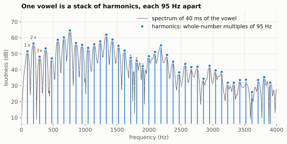
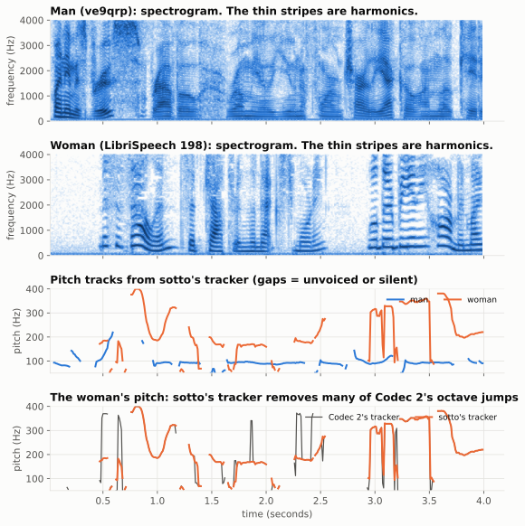

# 2. Pitch and voicing

Previous: [Sound and bits](01-sound-and-bits.md) · [Course home](README.md) · Next: [The spectral envelope](03-envelope.md)

## Big idea

Your vocal cords open and close many times a second, like a very fast buzzer. How fast they buzz is your **pitch**. When they aren't buzzing (as in "s", "f" or a whisper), the sound is **unvoiced** hiss. sotto measures both every 10 milliseconds.

## A quick review: sine waves and frequency

A **sine wave** is the smoothest possible wiggle. It has:

- a **frequency**: how many times it repeats per second, measured in hertz (Hz),
- an **amplitude**: how big it is,
- a **phase**: where in its cycle it starts.

A 100 Hz sine wave repeats every 1/100 of a second = 10 ms. In general:

> period (seconds) = 1 / frequency (Hz)

## Pitch is the repeat rate

Look back at the zoomed vowel in chapter 1. The pattern repeated every 10.5 ms. So the man's pitch at that moment was:

> 1 / 0.0105 s ≈ **95 Hz**

Typical speaking pitches are roughly 85–155 Hz for adult men and 165–255 Hz for adult women. Your pitch also moves all the time: it rises at the end of a question and falls at the end of a sentence.

## A buzz is made of harmonics

Here is the surprising part, and it is the most important idea in sotto. **Any sound that repeats can be built by adding up sine waves whose frequencies are whole-number multiples of the repeat rate.** These sine waves are called **harmonics**. (This is a famous result in math called *Fourier analysis*.)

So a 95 Hz buzz is really 95 Hz + 190 Hz + 285 Hz + 380 Hz + ... all playing at once, each with its own loudness.

This graph is a **spectrum**: instead of time along the bottom, it has *frequency*. Each peak is one harmonic. They sit exactly 95 Hz apart, all the way up to 4,000 Hz: 41 harmonics in all.

In the code, the number of harmonics is called **L**, and their loudnesses are called **A** (for amplitude). So the vowel in this picture is "L = 41 harmonics with amplitudes A₁, A₂, ... A₄₁".

## Pitch tracking

A **pitch tracker** (or pitch estimator) is the part of the encoder that measures the pitch. sotto starts from Codec 2's tracker, called **NLP** ("non-linear pitch"). Roughly, it:

1. squares the signal, which makes the buzz rate stand out even when the lowest harmonic is weak (as it is on a phone line),
2. looks for the strongest repeating rate between 50 and 400 Hz,
3. checks nearby candidates and fine-tunes the answer.

The top two pictures are **spectrograms**: time goes across, frequency goes up, and darker means louder. You can see the harmonics as thin parallel stripes. They're closer together for the man (low pitch) and further apart for the woman (higher pitch). When the stripes bend, the pitch is changing.

The third graph shows the pitch that sotto measured. For the man it is smooth, around 95 Hz.

### Octave errors, and how sotto v1 catches them

The bottom graph shows the woman's pitch two ways. Codec 2's tracker (gray) **jumps**: sometimes up near 350 Hz for a moment, sometimes down near 60 Hz. Her real pitch doesn't move like that. These are **octave errors**, where the tracker locks onto double or half the true pitch. Doubling and halving fit the harmonics almost as well as the truth: if the true pitch is 180 Hz, a "pitch" of 90 Hz also has a harmonic at 180, 360, 540 Hz and so on.

How common is it? Compared with a careful offline pitch tracker (pYIN), Codec 2's pitch was off by more than 20% on about 32% of the woman's voiced frames, against 14% and 6% for the two men. A wrong pitch puts the harmonics in the wrong places, and this was a main reason sotto v0 sounded worse on her voice.

**sotto v1's tracker** (orange) starts from Codec 2's answer and fixes the jumps. For every frame in a stretch of voiced speech it considers three candidates: Codec 2's pitch, double it, and half it, each fine-tuned. Then it picks one candidate per frame, choosing the path through the whole stretch that scores best on three things:

1. **Fit**: how well the harmonics at that pitch match the spectrum, up to 2,500 Hz.
2. **A slight preference for the higher pitch**, because half the true pitch fits almost as well as the truth (the 90 Hz example above).
3. **A penalty for jumping** between neighboring frames, because real pitch glides smoothly.

Finding the best path through all those choices is done with the **Viterbi algorithm**, the same method the radio receiver uses to fix bit errors (chapter 6). One extra rule: the doubled and halved candidates must stay above 70 Hz, so it doesn't halve a low man's voice.

It isn't perfect. Around 3.0–3.5 seconds both trackers put her near 330 Hz, and a simple check there can't tell whether that's right or an octave too high. And because the tracker looks at the whole voiced stretch before deciding, it needs to see ahead. A real-time version will have to decide after seeing only 40 to 60 ms ahead.

It does help. With only the tracker changed (nothing rounded yet), the woman's score rose from 2.77 to 3.10, and the men's went up a little too (scores are PESQ, chapter 7).

## Voicing

Not every sound is a buzz. To decide, Codec 2's **voicing detector** asks: *if I pretend this frame is a perfect set of harmonics at the measured pitch, how well does that match the real spectrum below 1,000 Hz?*

- A good match means a buzz: **voiced**.
- A bad match means noise: **unvoiced**.

It then double-checks with a simple rule: buzzes have most of their energy at low frequencies, and hiss has most of it at high frequencies.

sotto sends one voicing decision (1 bit: yes or no) for each 10 ms half of a frame, so 2 bits per 20 ms frame.

Real speech isn't always one or the other. A "z" or a "v" is a buzz *and* a hiss at the same time. A single yes/no can't describe that. Some vocoders (called MBE and MELP) send a separate voicing decision for different frequency bands. The team tried a version of this ("band voicing") for v1. It made no difference to the computer scores, so it's waiting until people can listen to it.

## How pitch is written in the code

The code doesn't store pitch in hertz. It uses **Wo** ("omega-zero"), the pitch written as an angle per sample:

> Wo = 2π × pitch ÷ 8000

So 95 Hz is Wo ≈ 0.075 radians per sample. The number of harmonics is L = ⌊π ÷ Wo⌋, which is the same as ⌊4000 ÷ pitch⌋. Chapter 4 shows how Wo is squeezed into 7 bits.

## Try it

1. A woman's pitch is 200 Hz. What is the period in milliseconds? How many harmonics fit below 4,000 Hz?
2. A tracker makes an octave error and reports 400 Hz instead of 200 Hz. Which of the true harmonics would the decoder be missing?
3. Whisper a sentence, then say it out loud. Which parts of the voice did you switch off when whispering?

## Where this is in the code

- `codec/codec2/src/nlp.c`: the NLP pitch tracker.
- `codec/codec2/src/sine.c`: `est_voicing_mbe()`, the voicing detector.
- `sim/sinusoid.py`: `track_pitch()`, sotto v1's octave-correcting tracker, and a Python copy of Codec 2's analysis.
- `sim/vocoder_lab.py`: `analyse()` runs Codec 2's analysis (`c2sim --modelout`) and returns one record per 10 ms with `Wo`, `L`, `A`, `phi` and `voiced`. `analyse(x, "tracked")` uses sotto's tracker instead.

Answers

1. 1/200 s = 5 ms. 4,000 ÷ 200 = 20 harmonics, the last one right at 4,000 Hz.
2. Every odd one: 200, 600, 1,000, 1,400 Hz and so on. Only the even ones (400, 800, ...) would be rebuilt, and the voice would sound an octave too high.
3. Whispering switches off voicing: every frame becomes unvoiced. You can hear this in chapter 5's "whisper" demo.

