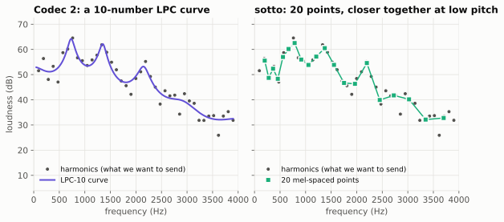
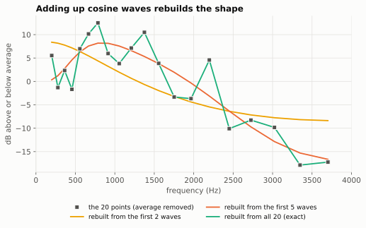

# 3. The spectral envelope

Previous: [Pitch and voicing](02-pitch-and-voicing.md) · [Course home](README.md) · Next: [Quantization](04-quantization.md)

## Big idea

Your vocal cords make the buzz. Your throat, tongue and lips *shape* it, making some harmonics loud and others quiet. That shape is what makes "ee" sound different from "oo", even at the same pitch. The smooth curve that describes it is called the **spectral envelope**. Describing the envelope well with few numbers is the main thing sotto v0 does differently from Codec 2.

## Source and filter

Speech scientists think of the voice as two parts:

- the **source**: the buzz from the vocal cords (or the hiss of air for unvoiced sounds),
- the **filter**: the tube of your throat and mouth, which makes certain frequencies ring louder.

Try singing one note and changing between "ee", "ah" and "oo". The pitch (the source) stays the same, but the sound changes. You're changing the filter.

The loud bumps the filter makes are called **formants**. In the harmonics picture from chapter 2, you can see bumps near 750 Hz, 1,300 Hz and 2,200 Hz. Those are formants.

## The envelope is the outline of the harmonics

If you draw a smooth line across the tops of the harmonics, you get the envelope. Why send the envelope instead of all the harmonic amplitudes?

1. **The count changes.** A low man's voice has around 40 harmonics. A child's might have 12. We want a fixed number of values, always the same size.
2. **It doesn't depend on pitch.** If you slide your pitch up while saying "ah", the harmonics move, but the outline stays the same. The decoder can place harmonics at *any* pitch and read their loudness off the envelope.

## Two ways to draw the envelope

Both panels show the same harmonics (gray dots) from one frame of the man's vowel.

**Left: Codec 2's way, LPC-10.** *Linear prediction* (LPC) describes the envelope with 10 numbers that define a smooth curve made of a few bumps. It's an elegant idea from the 1970s, and very efficient. In this frame it follows the big formant bumps well, but it smooths over details: the up-and-down of the lowest harmonics below 500 Hz, the height of the peak near 2,200 Hz, and the scattered harmonics above 2,500 Hz. Ten numbers can only make a few twists. Over thousands of frames, those small misses add up to a loss you can hear (see the table below).

**Right: sotto's way, 20 mel-spaced points.** sotto reads the envelope at **20 fixed frequencies**, by connecting the harmonic dots with straight lines (in decibels) and reading off the height at each of the 20 places. The code calls this the **rate-K envelope** (K = 20 is the number of points; the idea comes from a Codec 2 experiment called *newamp1*). The decoder does the reverse: it connects the 20 points and reads off the loudness at each harmonic.

The 20 frequencies are not evenly spaced. They're on the **mel scale**, a scale that matches how human hearing works: we notice small changes at low frequencies, but only bigger changes at high ones.

| Point | 1 | 2 | 3 | 4 | ... | 17 | 18 | 19 | 20 |
|---|---|---|---|---|---|---|---|---|---|
| Frequency (Hz) | 200 | 278 | 363 | 456 | ... | 2,725 | 3,024 | 3,348 | 3,701 |
| Gap to the next | 78 | 85 | 93 | 101 | ... | 299 | 324 | 353 | |

So sotto spends its points where your ears care most.

## Does it help? The numbers

The sotto team measured voice quality with a score called PESQ (chapter 7 explains it; higher is better, 4.5 is perfect). Starting from the full set of harmonic amplitudes, they swapped in each kind of envelope (these early tests used Codec 2's pitch tracker):

| Envelope | Woman | Man (LibriSpeech) | Man (VE9QRP) |
|---|---:|---:|---:|
| All harmonic amplitudes (no envelope at all) | 2.77 | 3.54 | 3.48 |
| Codec 2's LPC-10 | 2.61 | 2.98 | 2.94 |
| sotto's 20 mel points | 2.67 | 3.43 | 3.31 |

For the two men, LPC-10 loses about 0.55 points. That was the biggest single loss anywhere in Codec 2 (chapter 7 shows how they found that). The 20-point envelope gets most of it back. Using 16 or 20 LPC numbers instead of 10 barely helped, which is why sotto switched approach instead.

## Shape and level

sotto splits the 20 points into two parts:

- the **level**: how loud the whole frame is (sent as the 5-bit *energy*, chapter 4),
- the **shape**: the 20 values with their average subtracted, so they go up and down around zero.

This way, saying the same vowel loudly or softly gives the same shape.

## Squeezing the shape: cosine waves again

20 numbers is still a lot to send. Here's a neat trick. Adjacent points on the envelope are usually close to each other, because the envelope is smooth. So we rewrite the 20 shape values as a **sum of 20 cosine waves** stretched across the frequency axis:

- wave 0 is flat (that's the average, which we've already removed),
- wave 1 is one gentle slope from high to low (a "tilt"),
- wave 2 is one hump,
- ... and wave 19 wiggles up and down at every point.

This rewrite is called the **DCT** (discrete cosine transform). It's the same trick JPEG uses to shrink photos. Nothing is lost by the rewrite itself: 20 numbers in, 20 numbers out. But now most of the shape lives in the first few numbers.

With just 2 waves you get the overall tilt. With 5 you get the main formant humps. With all 20 you get the shape back exactly. Early versions of sotto rounded each wave's size separately; since v3, sotto's vector quantizer looks at the whole shape at once (chapter 4). The code still works with the cosine-wave sizes inside, because it's a convenient way to drop the average.

## Try it

1. The man's pitch is 95 Hz, so his harmonics are 95 Hz apart. Near 200 Hz, how many harmonics are there between two mel points? Near 3,500 Hz?
2. Why might a high voice (300 Hz pitch) be harder to describe with 20 envelope points? (Hint: how many harmonics are there to read the envelope from?)
3. JPEG and sotto both use the DCT. What is "smooth" in a photo, the way the envelope is smooth in sotto?

## Where this is in the code

- `sim/vocoder_lab.py`: `KFREQ` (the 20 mel frequencies), `to_rate_k()` and `from_rate_k()` (harmonics to points and back), `DCT` (the 20 × 20 cosine table).
- `sim/oracle_ladder.py` and `docs/encoder-v0.md`: the LPC-10 measurements.

Answers

1. Near 200 Hz the points are 78 Hz apart, less than one harmonic spacing, so there's about one harmonic per gap (some gaps have none). Near 3,500 Hz they're 353 Hz apart, so there are about 3 or 4 harmonics per gap.
2. At 300 Hz there are only 13 harmonics below 4,000 Hz. The envelope is only measured at those 13 places, so the 20 points are mostly guesses between them. This is one suspected reason sotto does worse on women's and children's voices.
3. In a photo, neighboring pixels usually have similar colors (a blue sky, a wall), so the image is smooth across space.

