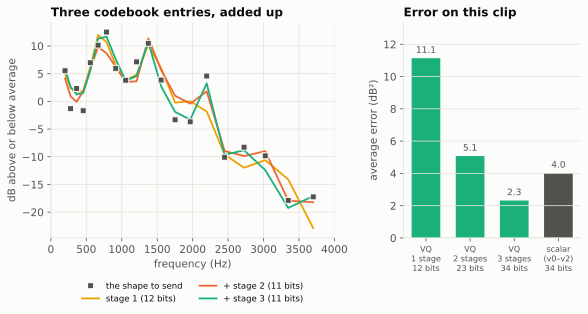

# 4. Quantization: fitting it into 48 bits

Previous: [The spectral envelope](03-envelope.md) · [Course home](README.md) · Next: [Synthesis](05-synthesis.md)

## Big idea

Pitch, energy and the envelope are measured as precise decimal numbers. But we can only send whole bits. **Quantization** means rounding each number to the nearest of a small set of allowed values, and sending which one it was. The art is choosing those values so the rounding is as hard to hear as possible.

## Bits and levels

With **n** bits you can send one of **2ⁿ** different messages:

| Bits | Levels |
|---:|---:|
| 1 | 2 |
| 2 | 4 |
| 5 | 32 |
| 7 | 128 |

So if a quantizer has 5 bits, the receiver can only ever get one of 32 possible values. The difference between the true value and the value received is the **quantization error**.

## A uniform quantizer: the energy

The simplest quantizer has evenly spaced steps, like the marks on a ruler. sotto sends frame **energy** (how loud the frame is, in decibels) with 5 bits, spread evenly from 10 dB to 80 dB:

> step = (80 − 10) ÷ 31 = 2.26 dB

Left: the "staircase". Any loudness in one step's range comes out as that step's value. Right: one second of the man's speech. The true energy (gray) is wiggly. The quantized energy (blue) follows it in steps of 2.26 dB. A change of 1 to 2 dB in loudness is about the smallest most people notice, so these steps are small enough.

The lowest step, code 0, is special: since v3 it means **true silence**. Before that, the quietest code still played a faint hiss, and a listener noticed it as a "floor" in the gaps between words.

## A logarithmic quantizer: the pitch

For pitch, sotto uses 7 bits (128 levels) from 50 Hz to 500 Hz. But the levels are not evenly spaced in hertz. Each level is **1.83% higher** than the one below it.

Why? Because our ears hear pitch by *ratio*, not by difference. Going from 100 Hz to 200 Hz sounds like the same jump (one octave) as going from 200 Hz to 400 Hz. A piano is built the same way: each key is about 5.9% higher than the one before. sotto's pitch steps are about a third of a piano key, so a man at 100 Hz and a woman at 200 Hz get equally fine steps.

This is called a **log-uniform** quantizer: uniform steps in the *logarithm* of the pitch.

## Voicing

The 2 voicing bits carry one of four codes for the whole 20 ms frame: U U, V V, M M, or an edge between unvoiced and mixed (chapter 2).

## The shape quantizer

That leaves 34 bits for the envelope shape, the 20 points with their average removed (chapter 3). The part of sotto that rounds the shape into bits is the **shape quantizer**. It has had two designs.

### Before v3: one number at a time

Versions v0 to v2 used a **scalar** quantizer (the `ShapeQ` class): it rounded each of the 19 cosine-wave sizes from chapter 3 on its own, with its own staircase. It handed out the 34 bits one at a time, each to whichever wave it would help most (**greedy bit allocation**), so the slow tilts and humps got 3 to 5 bits each and the fine wiggles got 1 or none. It was simple, but it wasted bits, because the 19 numbers aren't independent: real mouth shapes only make certain combinations.

### Since v3: a vector quantizer

A **vector quantizer** (VQ) rounds all the numbers *together*. Picture a book of typical envelope shapes, learned from real speech: the **codebook**. Each page holds one shape, written as a list of 19 numbers. The encoder and the decoder have identical copies of the book. The encoder finds the page closest to this frame's shape and sends just its page number; the decoder looks up that page and reads the shape back out. The shape itself never travels, only the page number. With 12 bits, the codebook can have 2¹² = 4,096 pages.

It's like ordering paint by its number on a color chart: you don't describe the color, you say "number 2417", and the store has the same chart.

4,096 shapes still can't match every frame closely. So sotto uses **three stages**:

1. **Stage 1** (12 bits): pick the closest of 4,096 shapes.
2. **Stage 2** (11 bits): look at what's left over (the true shape minus the stage-1 shape). Pick the closest of 2,048 *corrections*.
3. **Stage 3** (11 bits): correct what's left after that, again from 2,048 choices.

The decoder adds the three entries together. 12 + 11 + 11 = 34 bits. This is called a **multistage VQ**.

Left: on the man's vowel, stage 1 gets the overall shape, and each later stage fixes details. Right: the average error over the whole clip. After all three stages the VQ's error is about half of what the old scalar quantizer had with the same 34 bits. On a large set of test voices the team measured 45% less error (2.54 against 4.66 dB²), with both quantizers trained on the same speech.

One more trick: the best stage-1 choice doesn't always lead to the best final answer. So the encoder keeps the **8 best paths** at each stage, not just one, and picks the best total at the end. This is called an **M-best search** (M = 8).

### Training the codebook

Where do the 8,192 codebook entries come from? From **training** on recordings of real people. The method is called **k-means clustering**:

1. Start with a guess for each codebook entry.
2. Sort every training shape into the group of the entry it's closest to.
3. Move each entry to the average of its group.
4. Repeat until the entries stop moving.

Stage 2 is trained the same way, on what stage 1 left over, and so on. sotto's codebook is trained on about 480,000 frames from more than 600 speakers: short words from Google's *Speech Commands* collection (300 lower and 300 higher voices) plus audiobook readers from *LibriSpeech*. Both collections are free to reuse (CC BY 4.0). It's stored in the file `sim/data/shape_msvq_34.npz`.

To keep the tests fair, the voices used for testing are never used for training. That's called keeping test data **held out**. On 16 held-out voices from LibriSpeech and another studio collection (EARS), sotto beat Codec 2 on every one, by about 0.45 to 0.6 PESQ.

### Shrinking the codebook for the radio (v3.6)

The codebook has to be stored inside the radio. All three stages together have 8,192 pages × 19 numbers = 155,648 numbers. The DSP chip in the radio (a TI C5517) has only 320 KB of memory, and the radio modem needs to share it. Even with each number squeezed into 8 bits (one byte), the codebook would take 152 KB, about half of the chip.

The codebook is also slow. To find the best pages, the encoder compares the shape with every page in every stage, keeping 8 paths. That's about 700,000 multiply-and-add steps every 20 ms, and **90% of the encoder's work**.

So for v3.6 the team rebuilt it with **four smaller stages** instead of three big ones:

| | Stages (bits) | Pages | Size (8-bit numbers) | Work per frame | PESQ |
|---|---|---|---|---|---|
| v3.5 | 12 + 11 + 11 | 8,192 | 152 KB | 700,000 | 2.917 |
| v3.6 | 9 + 9 + 8 + 8 | 1,536 | **29 KB** | **165,000** | 2.913 |

It's still 34 bits, so the frame doesn't change. Each stage is much smaller (512 or 256 pages), and the extra stage makes up for it by adding one more correction. The codebook is now a fifth of the size, and the search needs about a quarter of the work. Each number is also rounded to 8 bits, the way the chip will store it.

Why doesn't it sound worse? Adding pages helps less and less: the first few hundred pages capture the common mouth shapes, and thousands more mostly split hairs. Four small stages, each fixing what the last one missed, can still combine into 2³⁴ different final shapes, the same number as before. The PESQ change (2.917 to 2.913) is too small to matter, and two blind listening rounds agreed: the small codebook against the big one gave 5 ties out of 5 (round 9), and the full v3.6 against v3.5 gave 2 wins for v3.6 and 8 ties (round 10).

v3.6 also changed how **energy** is measured. The envelope only covers 200 to 3,700 Hz, so the encoder now sends only the loudness the decoder can actually rebuild in that range. Before, a voice with a strong hum below 200 Hz had that hum's loudness spread across the whole envelope, which made a buzzy "chirp" at the start of one clip.

## Putting the 48 bits together

The bits go out in order of importance: voicing first, then pitch, then energy, then the three shape stages. If the radio link can protect some bits better than others, the important ones are easy to find.

## Two more tricks

**Sending half the frames.** The encoder analyzes the voice every 10 ms, but it only sends every second analysis (once per 20 ms). The decoder fills in the missing 10 ms in between by **interpolation**, which just means taking values halfway between the frames on either side. The voicing for both halves *is* sent, because a voicing change is too important to guess.

**Memoryless frames.** Each 48-bit frame can be decoded on its own, without knowing the frame before. The team has tried *predicting* each frame's shape from the previous one and sending only the difference, since your mouth can only move so fast. Over fading radio channels that made things worse (−0.1 to −0.26), because when one frame is lost, the decoder's prediction stays out of step for several frames afterwards. A later try *reset* the prediction on every unvoiced frame, which halved that loss, but prediction still gained nothing with the old scalar quantizer. So sotto stays **memoryless** for now. Prediction may get another try with the vector quantizer. (In the code those experiments are `SottoV1` and `SottoV2P`; the real versions are `SottoV0` with a better tracker, then `SottoV2`, `SottoV3` and so on.)

## Try it

1. If energy had 6 bits instead of 5 over the same 10–80 dB range, what would the step size be? Where could that extra bit come from?
2. sotto's pitch levels are each 1.83% apart. Starting at 50 Hz, what are the next two levels? How many steps make one octave (doubling)?
3. A friend says: "Why not one stage with 34 bits instead of three stages?" How many codebook entries would that need? Why might that be a problem?
4. Check the v3.6 codebook: how many pages do stages of 9, 9, 8 and 8 bits have in total? With 19 numbers per page and one byte per number, how many bytes is that?

## Where this is in the code

- `sim/vocoder_lab.py`: `q_uniform()` (uniform quantizer), `q_wo()` (log pitch quantizer), `ShapeMSVQ` (the 3-stage VQ and its M-best search), `ShapeQ` (the older scalar quantizer), `SottoV0.encode()` and `SottoV0.decode()` (the 48-bit layout), `decimate_interp()` and `interp_wo()` (filling in the 10 ms frames).
- `tools/train_shape_vq.py`, `tools/sc_corpus.py`, `tools/clean_corpus.py`: building the training data and the codebook. `sim/data/shape_msvq_34.npz`: the v3.5 codebook. `sim/data/shape_msvq_9988.npz`: the smaller v3.6 codebook, used by `SottoV36` and the C port (`docs/c-port.md` has the memory and speed numbers).

Answers

1. 70 ÷ 63 ≈ 1.11 dB. It would have to come from another field, for example one less bit for the shape (33 instead of 34).
2. 50 × 1.0183 ≈ 50.9 Hz, then ≈ 51.8 Hz. An octave takes about 38 steps (1.0183³⁸ ≈ 2). From 50 to 500 Hz is a factor of 10, about 3.3 octaves, and 3.3 × 38 ≈ 127 steps, which is why 128 levels cover it.
3. 2³⁴ is about 17 billion entries. That's far too many to store on a small radio chip or to search 50 times a second, and there isn't nearly enough training speech to learn them. Three stages need only 4,096 + 2,048 + 2,048 = 8,192 entries.
4. 512 + 512 + 256 + 256 = 1,536 pages. 1,536 × 19 = 29,184 bytes, about 29 KB (one KB is 1,024 bytes).

