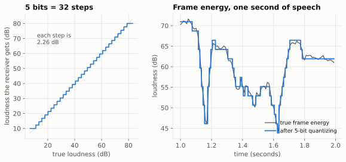

# 4. Quantization: fitting it into 48 bits

Previous: [The spectral envelope](03-envelope.md) · [Course home](README.md) · Next: [Synthesis](05-synthesis.md)

## Big idea

Pitch, energy and the envelope are measured as precise decimal numbers. But we can only send whole bits. **Quantization** means rounding each number to the nearest of a small set of allowed values, and sending which one it was. The art is choosing those values so the rounding is as hard to hear as possible.

## Bits and levels

With **n** bits you can send one of **2ⁿ** different messages:

| Bits | Levels |
|---:|---:|
| 1 | 2 |
| 2 | 4 |
| 5 | 32 |
| 7 | 128 |

So if a quantizer has 5 bits, the receiver can only ever get one of 32 possible values. The difference between the true value and the value received is the **quantization error**.

## A uniform quantizer: the energy

The simplest quantizer has evenly spaced steps, like the marks on a ruler. sotto sends frame **energy** (how loud the frame is, in decibels) with 5 bits, spread evenly from 10 dB to 80 dB:

> step = (80 − 10) ÷ 31 = 2.26 dB

Left: the "staircase". Any loudness in one step's range comes out as that step's value. Right: one second of the man's speech. The true energy (gray) is wiggly. The quantized energy (blue) follows it in steps of 2.26 dB. A change of 1 to 2 dB in loudness is about the smallest most people notice, so these steps are small enough.

## A logarithmic quantizer: the pitch

For pitch, sotto uses 7 bits (128 levels) from 50 Hz to 400 Hz. But the levels are not evenly spaced in hertz. Each level is **1.65% higher** than the one below it.

Why? Because our ears hear pitch by *ratio*, not by difference. Going from 100 Hz to 200 Hz sounds like the same jump (one octave) as going from 200 Hz to 400 Hz. A piano is built the same way: each key is about 5.9% higher than the one before. sotto's pitch steps are about a third of a piano key, so a man at 100 Hz and a woman at 200 Hz get equally fine steps.

This is called a **log-uniform** quantizer: uniform steps in the *logarithm* of the pitch.

## Voicing

Voicing is already just yes or no: 1 bit for each 10 ms half of the frame, 2 bits in all.

## The shape quantizer

That leaves 34 bits for the envelope shape. Remember from chapter 3 that sotto rewrites the shape as the sizes of 19 cosine waves (wave 0, the average, is sent as energy instead). The **shape quantizer** (the `ShapeQ` class in the code) decides how to round each of those 19 sizes.

It makes two choices.

**1. How many bits does each wave get?** The early waves (slow tilts and humps) matter most and vary the most. The late waves (fine wiggles) are small. sotto hands out the 34 bits **one at a time**. Each bit goes to whichever wave it would help most at that moment, measured by how much it shrinks the average error. This is called **greedy bit allocation**. The result, shown on the right of the DCT figure in chapter 3, is:

| Wave | 1 | 2 | 3 | 4 | 5–11 | 12–15 | 16–17 | 18 | 19 |
|---|---|---|---|---|---|---|---|---|---|
| Bits | 5 | 4 | 3 | 3 | 2 each | 1 each | 0 | 1 | 0 |

Waves with 0 bits aren't sent at all: the decoder just uses zero.

**2. How big is each step?** Each wave gets its own uniform quantizer. The step size is found by trying 60 different sizes and keeping the one with the smallest average error. Too big a step and every value is rounded a lot. Too small and big values fall off the ends of the staircase.

Both choices are made by **training**: running the quantizer on a lot of real speech and measuring the error. sotto's training speech is the set of test recordings that come with Codec 2. To keep the test fair, the stretch of the VE9QRP recording used in testing is cut out of the training set, and the LibriSpeech voices used in testing are never used for training at all. That's called keeping test data **held out**.

## Putting the 48 bits together

The bits go out in order of importance: voicing first, then pitch, then energy, then the shape waves from biggest to smallest. If the radio link can protect some bits better than others, the important ones are easy to find.

## Two more tricks

**Sending half the frames.** The encoder analyzes the voice every 10 ms, but it only sends every second analysis (once per 20 ms). The decoder fills in the missing 10 ms in between by **interpolation**, which just means taking values halfway between the frames on either side. The voicing for both halves *is* sent, because a voicing change is too important to guess.

**Memoryless frames.** Each 48-bit frame can be decoded on its own, without knowing the frame before. The team tried *predicting* each frame's shape from the previous one and sending only the difference. With no radio noise that was a little better (+0.1 to +0.3 PESQ in v0's first try, +0.0 to +0.1 in v1's). But in v1's tests over fading radio channels it was *worse* (−0.1 to −0.26), because when one frame is lost, the decoder's prediction stays out of step for several frames afterwards. So sotto stays **memoryless**. (In the code, that predictive experiment is the class `SottoV1`; the real v1 is `SottoV0` with the new pitch tracker.)

## Try it

1. If energy had 6 bits instead of 5 over the same 10–80 dB range, what would the step size be? Where could that extra bit come from?
2. sotto's pitch levels are each 1.65% apart. Starting at 50 Hz, what are the next two levels? How many steps make one octave (doubling)?
3. Why does the greedy allocator give wave 1 the most bits, and the high waves 0 or 1?

## Where this is in the code

- `sim/vocoder_lab.py`: `q_uniform()` (uniform quantizer), `q_wo()` (log pitch quantizer), `ShapeQ` (step sizes and greedy bit allocation), `training_set()`, `SottoV0.encode()` and `SottoV0.decode()` (the 48-bit layout), `decimate_interp()` and `interp_wo()` (filling in the 10 ms frames).

Answers

1. 70 ÷ 63 ≈ 1.11 dB. It would have to come from another field, for example one less bit for the shape (33 instead of 34).
2. 50 × 1.0165 ≈ 50.8 Hz, then ≈ 51.7 Hz. An octave takes about 42 steps (1.0165⁴² ≈ 2). From 50 to 400 Hz is 3 octaves, and 3 × 42 ≈ 127 steps, which is why 128 levels cover it.
3. Wave 1 (the overall tilt) changes the most from frame to frame and has the biggest effect on the sound, so each bit spent on it removes the most error. The high waves are small fine details: rounding them to zero costs little.

