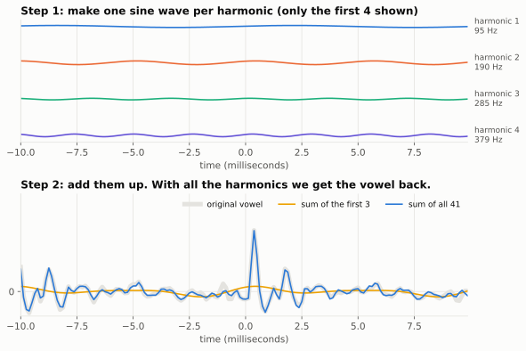
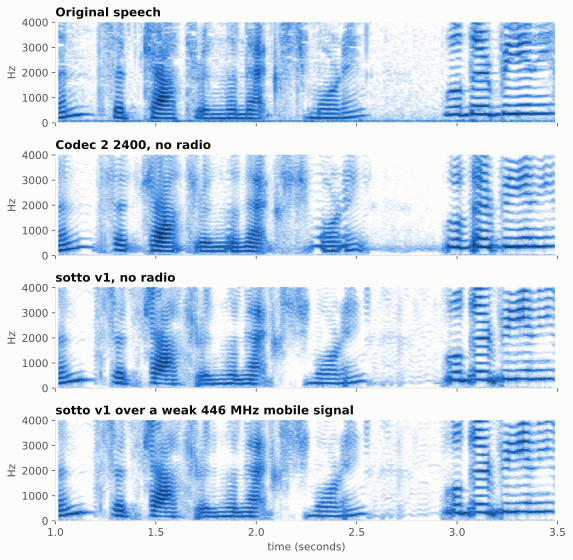

# 5. Synthesis: rebuilding the voice

Previous: [Quantization](04-quantization.md) · [Course home](README.md) · Next: [Across the radio](06-radio.md)

## Big idea

The decoder turns the 48 bits back into pitch, voicing, energy and envelope, and then **plays** them. For a voiced frame it adds up one sine wave per harmonic. For an unvoiced frame it does the same with scrambled phases, which sounds like hiss. This is called **sinusoidal synthesis**, and it's the reverse of everything in chapters 2 and 3.

## Step by step

For each 10 ms piece of sound the decoder:

1. **Unpacks the bits** into voicing, pitch (Wo), energy and the 16 shape numbers (chapter 4).
2. **Rebuilds the envelope**: turns the shape numbers back into 20 points with the inverse DCT, and adds the level.
3. **Sharpens the envelope** with a *formant postfilter* (see below).
4. **Places the harmonics**: with pitch Wo, there are L = ⌊π ÷ Wo⌋ harmonics. Each one's loudness is read off the envelope at its frequency.
5. **Sets the total loudness** to the sent energy.
6. **Chooses phases**: the starting point of each sine wave (see below).
7. **Adds up all the sine waves**, and blends each 10 ms piece smoothly into the next.

## Adding up sine waves

Here's step 7 on the vowel from chapter 2. To show that the idea really works, this picture uses the *true* amplitudes and phases measured from the recording:

Top: the first four harmonics on their own: 95 Hz, 190 Hz, 285 Hz and 379 Hz. Bottom: adding the first three gives only a smooth wobble at the pitch rate (yellow). Adding all 41 gives back the sharp pulse of the vocal cords, and it lies right on top of the original (gray).

## The phase problem

There's a catch: sotto doesn't send phases. 41 phases would cost far more than 48 bits. So the decoder has to **make them up**. Codec 2's trick, which sotto uses, is to pretend that each vocal-cord pulse is a single sharp click, played through the mouth-shaped filter. That gives a believable phase for every harmonic, from the pitch and envelope alone. The code calls this **phase0** or *synthetic phase*.

For unvoiced frames, the phases are chosen **at random**. Sine waves with random phases add up to noise instead of a pulse. That's how the same machinery makes both buzz and hiss.

Made-up phases are not free. In chapter 7 you'll see they cost about 0.3 to 0.7 PESQ points. They're one reason vocoded speech can sound a little "buzzy".

## Two different "postfilters"

The word *postfilter* (a filter applied after decoding) means two different things in this project:

- **sotto's formant postfilter.** Before placing the harmonics, sotto stretches the envelope's ups and downs by a factor of 1.5 (in decibels), and then puts the total loudness back. Peaks get sharper and valleys get deeper. Rounding in the quantizer tends to blur the envelope, and this undoes some of the blur. The idea comes from Codec 2's newamp1 experiments.
- **Codec 2's `--postfilter`.** This one doesn't touch the envelope. It keeps a running estimate of the background noise level. In voiced frames, any harmonic quieter than that noise gets a random phase, so background noise sounds like noise instead of a clicky buzz. It costs zero bits.

sotto uses both.

## Listen: break one piece at a time

The best way to understand each part is to switch it off and listen. Each of these clips is the same 6 seconds of VE9QRP. All but the first went through Codec 2's synthesizer with one thing changed. (Headphones help.)

| Clip | What changed | What to listen for |
|---|---|---|
| <audio controls preload="none" src="audio/original.flac"></audio> [original.flac](audio/original.flac) | Nothing: the input recording | |
| <audio controls preload="none" src="audio/model.flac"></audio> [model.flac](audio/model.flac) | Every harmonic amplitude kept exactly; made-up phases | The best the harmonic model can do without sending phases |
| <audio controls preload="none" src="audio/whisper.flac"></audio> [whisper.flac](audio/whisper.flac) | Every frame forced to *unvoiced* | Voicing off: a whisper. Still understandable! |
| <audio controls preload="none" src="audio/monotone.flac"></audio> [monotone.flac](audio/monotone.flac) | Pitch fixed at 110 Hz; envelope kept | Pitch off: a robot. The words survive, the melody doesn't |
| <audio controls preload="none" src="audio/flat_envelope.flac"></audio> [flat_envelope.flac](audio/flat_envelope.flac) | All harmonics equally loud; pitch and voicing kept | Envelope off: a buzz with a tune, and the words get much harder to make out |
| <audio controls preload="none" src="audio/sotto_v1.flac"></audio> [sotto_v1.flac](audio/sotto_v1.flac) | The real thing: sotto v1, 48 bits per 20 ms | Everything rounded to fit 2,400 bits per second |

What these show:

- The **envelope** carries the words. Take it away and you can't understand anything.
- The **pitch** carries the melody and much of who is speaking. Take it away and the words are still clear.
- **Voicing** decides buzz or hiss. Take it away and you get a whisper.

## Seeing the whole thing rebuilt

Here are spectrograms of the woman's voice, before and after.

- **Original**: sharp harmonic stripes and clear formant bands.
- **Codec 2 2400** and **sotto v1**: both keep the stripes and the main bands, but finer detail is blurred. Where Codec 2's pitch tracker made octave errors, its stripes land in the wrong places; sotto v1's tracker avoids many of those (chapter 2). The difference is easier to hear than to see: PESQ scores this voice 2.16 for Codec 2 and 2.68 for sotto v1.
- **sotto v1 over a weak, fading 446 MHz signal** from a moving car: close to the no-radio version, with short smudges where frames were lost and hidden (chapter 6).

You can hear all of these, for three voices, on the [listening page](../index.html).

## Try it

1. Why can't a vocoder with made-up phases ever perfectly match the original waveform, even if it sounds good?
2. In the "monotone" clip, could you still tell it's the same speaker? What does that suggest about how much of a voice's identity is in the pitch?
3. A friend says: "Just send the 41 harmonic amplitudes instead of an envelope." Use the bit budget to explain why that doesn't work.

## Where this is in the code

- `sim/vocoder_lab.py`: `SottoV0.decode()` (steps 1–5), `postfilter_rk()` (the formant postfilter), `synthesise()` (runs `c2sim --modelin --phase0 --postfilter`).
- `codec/codec2/src/phase.c`: `phase_synth_zero_order()`, the made-up phases.
- `codec/codec2/src/postfilter.c`: Codec 2's background-noise postfilter.
- `codec/codec2/src/sine.c`: `synthesise()`, adding the sine waves and blending frames.
- `tools/course_figures.py`: `demos()` makes the six clips above.

Answers

1. The waveform's exact shape depends on the phases. Different phases give a different-looking wiggle, even when the harmonic loudnesses (which is mostly what the ear hears) are the same.
2. Usually you can still tell. Much of a voice's identity is in the envelope (the size and shape of the speaker's throat and mouth), not only in the pitch.
3. With 41 amplitudes and 34 bits, each would get less than 1 bit. Also the count changes with pitch, which makes a fixed 48-bit frame awkward.

