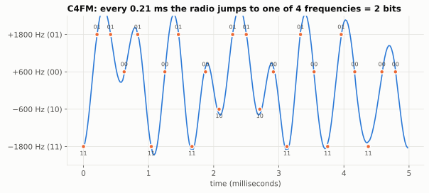
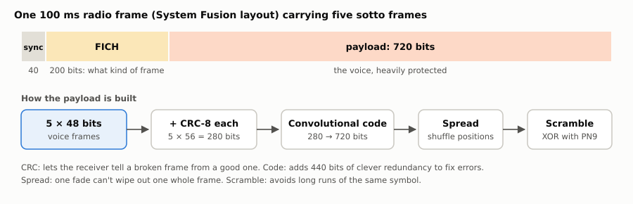
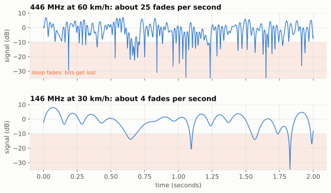
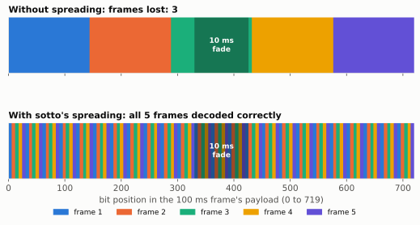

# 6. Across the radio

Previous: [Synthesis](05-synthesis.md) · [Course home](README.md) · Next: [How we measure "better"](07-measuring.md)

## Big idea

The vocoder makes 2,400 bits per second. But radio signals get noisy, and in a moving car they fade in and out many times a second. So before sending, sotto adds **extra bits** that let the receiver find and fix errors, and it **shuffles** the bits so one fade can't wipe out one whole frame. Then the bits are turned into radio frequency hops called **C4FM**.

## Turning bits into a radio signal: C4FM

sotto uses the same kind of signal as Yaesu's System Fusion radios. It's called **C4FM** (4-level FM). The transmitter's frequency hops between four values, 4,800 times a second. Each hop carries 2 bits:

| Frequency shift | Bits |
|---:|---|
| +1,800 Hz | 01 |
| +600 Hz | 00 |
| −600 Hz | 10 |
| −1,800 Hz | 11 |

4,800 hops × 2 bits = 9,600 bits per second on the air. The hops are smoothed (the curvy blue line) so the signal doesn't splatter onto neighboring channels. The receiver measures the frequency at the center of each hop (orange dots) and decides which of the four levels it was closest to.

Because only the *frequency* changes, the signal's strength stays constant. That's what lets it work through an ordinary FM radio's transmitter.

## The 100 ms frame

The bits are sent in **frames** of 100 ms = 960 bits:

- **Sync** (40 bits): a fixed pattern the receiver searches for, to know where each frame starts.
- **FICH** (200 bits): a small header saying what kind of frame this is. It has its own protection (a Golay code and a CRC-16).
- **Payload** (720 bits): the voice.

100 ms of voice is 5 sotto frames × 48 bits = 240 bits. But the payload has room for 720. sotto uses the extra 480 bits for protection. (Yaesu's own "DN" mode uses only part of the payload for voice. sotto uses the whole "VW" voice slot, because the team's simulations showed that spending the space on stronger protection gives about 6 dB more margin: it works with a signal about one quarter as strong.)

## Step 1: a CRC on each frame

A **CRC** (cyclic redundancy check) is a short fingerprint calculated from the data. sotto adds an 8-bit CRC to each 48-bit frame. The receiver recalculates it. If the fingerprints don't match, the frame is broken. A CRC can't *fix* anything, but it tells the receiver which frames not to trust.

## Step 2: an error-correcting code

Next the 5 × 56 = 280 bits go through a **convolutional code**. Every output bit is a mix (using XOR) of the last 7 input bits. Out come 720 bits: about 2.6 output bits for every input bit.

Because each input bit affects many output bits, and each output bit depends on several input bits, a few wrong bits don't destroy the message. The receiver uses the **Viterbi algorithm**: it considers the possible messages and finds the one that best explains what it received, even with errors sprinkled in. It's like reading a sentence with a few smudged letters: the letters around them tell you what they must have been.

The receiver also uses **soft bits**. Instead of deciding "this is a 1" right away, the demodulator says *how sure* it is ("probably a 1", "definitely a 0", "no idea"). The Viterbi decoder trusts the confident bits more. The code calls these confidence values **LLRs** (log-likelihood ratios).

## Step 3: spreading

Radio signals in a moving car **fade**. Reflections off buildings and hills add together, sometimes helping and sometimes canceling. The signal strength dips sharply many times a second:

At 446 MHz and 60 km/h there are about 25 dips per second, each very short. At 146 MHz and 30 km/h there are only about 4, but each one lasts much longer. Long fades are the hardest case.

During a deep fade, a whole run of bits in a row comes out as garbage. If all of one frame's bits sat together, that frame would be lost. So sotto **spreads** the bits: it shuffles the 720 positions so that each frame's bits are sprinkled across the whole 100 ms. This is also called *interleaving*.

This is a real run of sotto's encoder and decoder with a 10 ms burst of garbage in the middle of the payload. Without spreading, the burst lands mostly on frame 3, and frame 3 is lost. With spreading, every frame loses only a few bits, the code fixes them all, and all 5 frames come through.

## Step 4: scrambling

Last, the bits are mixed (XOR) with a fixed pseudo-random pattern called **PN9**. This avoids long runs of the same symbol, which a computer sound card (which can't pass a steady level) would distort. The receiver mixes with the same pattern again to undo it.

## At the receiver

The receiver runs the steps backwards:

1. **Find frames** by searching for the sync pattern. Once locked on, it expects the next frame exactly 100 ms later (the code calls this the **flywheel**), so a fade doesn't make it lose its place.
2. **Measure each hop** and turn it into soft bits.
3. **Unscramble, unspread, and run the Viterbi decoder.**
4. **Check each frame's CRC.**
5. **Hide the damage.** A frame that fails its CRC is replaced by the last good frame (up to 3 times in a row), then by silence. This is called **concealment**. A repeated 20 ms frame is much less annoying than a burst of garbage noise.

Because sotto is memoryless (chapter 4), a lost frame doesn't damage the frames after it.

## The software modem

sotto includes a **softmodem**: a program that does all of this in software. It lets people try sotto without Yaesu hardware, using an FM radio's 9600-baud data jack and a computer sound card, or a software-defined radio (SDR).

## How well does it work?

From `docs/encoder-v0.md` and `docs/encoder-v1.md`, all three codecs sent through the identical radio chain (scores are PESQ, chapter 7; higher is better):

| Condition | Codec | Woman | Man (LibriSpeech) | Man (VE9QRP) |
|---|---|---:|---:|---:|
| No radio | Codec 2 2400 | 2.16 | 2.91 | 2.85 |
| | sotto v0 | 2.50 | 3.14 | 2.88 |
| | **sotto v1** | **2.68** | **3.28** | 2.83 |
| 446 MHz, 60 km/h, weak signal | Codec 2 2400 | 1.69 | 2.29 | 2.49 |
| | sotto v0 | 2.11 | 2.68 | 2.69 |
| | **sotto v1** | **2.27** | **2.77** | 2.62 |
| 146 MHz, 30 km/h | Codec 2 2400 | 1.82 | 2.06 | 1.91 |
| | sotto v0 | 2.19 | 2.61 | 2.31 |
| | **sotto v1** | **2.28** | **2.66** | 2.25 |

Both sotto versions beat Codec 2 over the radio in every case. v1's better pitch tracking helps the woman most (+0.1 to +0.2 over v0). The VE9QRP voice scores slightly lower in v1, by an amount the team considers within the noise of these tests, and is level with Codec 2 with no radio. The slow VHF fades are the hardest, as the fading picture suggests.

## Try it

1. A C4FM signal makes 4,800 hops a second with 2 bits each. If it used 8 frequencies instead of 4, how many bits per hop would it carry? Why might that be harder for the receiver?
2. The sotto payload turns 280 bits into 720. What fraction of the payload is actually voice (the 240 vocoder bits)?
3. At 446 MHz and 60 km/h a fade might last about 2 ms. At 146 MHz and 30 km/h it might last 15 ms or more. Why are longer fades harder to fix, even with spreading?

## Where this is in the code

- `modem/c4fm.py`: the C4FM modulator and demodulator (sync search, flywheel, soft bits).
- `modem/ysf.py`: the frame layout, FICH, Golay code and CRC-16.
- `modem/payload.py`: `SottoVW`, which adds the CRC-8, runs the code, spreads and scrambles.
- `modem/fec.py`: the convolutional code, puncturing and Viterbi decoder.
- `modem/link.py`: `Transmitter` and `Receiver`, including concealment.
- `sim/c4fm_sim.py` and `sim/waveforms.py`: the simulated radio channel with noise and fading.
- `docs/softmodem.md`, `docs/waveform-race.md`: details and design choices.

Answers

1. 3 bits per hop (2³ = 8). The levels would be closer together, so a little noise could more easily push one level into its neighbor.
2. 240 ÷ 720 = one third. The other two thirds are CRCs and error correction.
3. A 15 ms fade garbles about 144 bits in a row, about a fifth of the whole frame. Spreading still splits it among all five frames, but every frame now loses many bits at once, which can be more than the code can fix.

