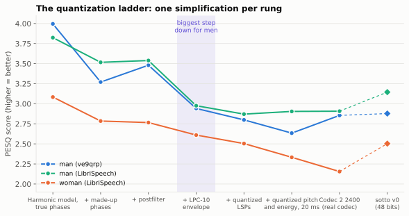
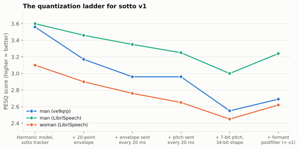

# 7. How we measure "better"

Previous: [Across the radio](06-radio.md) · [Course home](README.md) · Next: [Glossary](glossary.md)

## Big idea

"Does it sound better?" is a hard question to answer fairly. sotto's team uses computer scores that predict what listeners would say, and a kind of experiment called an **oracle** test, where part of the system is allowed to cheat. Stacking oracle tests one on top of another makes a **quantization ladder** that shows exactly where quality is lost.

## Scoring speech with a computer

The best test is to play clips to many people and ask them to rate them. That's slow, so during development sotto uses two scores that compare a decoded clip with the original:

- **PESQ** ("perceptual evaluation of speech quality") predicts how people would rate the *quality*, on a scale from about 1 (bad) to 4.5 (perfect). It's an international standard, built by fitting a model of human hearing to thousands of real listening tests. A clip compared with itself scores about 4.5; most low-bitrate vocoders land between 2.5 and 3.5.
- **ESTOI** predicts *intelligibility*: what fraction of the words a listener would understand, from 0 to 1.

These are predictions, not people. They can be fooled. For example, sotto's formant postfilter might flatter PESQ more than it helps real listeners. That's why the design notes list a listening panel as a next step.

## What's an oracle?

In computer science, an **oracle** is a helper that magically knows the right answer. In vocoder experiments, an oracle test means: *let one part use the true, perfect values instead of its normal estimate or its rounded value, and see how much better the result gets.*

For example, a **pitch oracle** test gives the decoder the true pitch instead of the 7-bit rounded pitch (or a carefully checked pitch instead of the tracker's guess). If quality jumps up, pitch is worth working on. If it barely moves, spend your effort elsewhere. Oracle tests are cheap: you don't have to invent a better pitch tracker to find out whether one would help.

In the code, oracle experiments work by running Codec 2's analysis, saving its model (pitch, voicing and harmonic amplitudes for every 10 ms) to a file, editing that file in Python, and then synthesizing from the edited file (`c2sim --modelout` and `--modelin`).

## The quantization ladder

Now stack the oracles. Start at the top rung with everything perfect: the true harmonic amplitudes, the true phases, no rounding. Then go down one rung at a time, each time taking away one oracle, so one more piece becomes realistic. At the bottom you reach the real codec. The drop between two rungs is exactly what that one piece costs.

The team built this ladder for Codec 2 2400 (the code calls it the **oracle ladder**; "quantization ladder" means the same thing):

Reading it from left to right:

| Rung | What became realistic | What it cost |
|---|---|---|
| Harmonic model, true phases | Nothing yet: perfect harmonics | (starting point) |
| + made-up phases | Phases are invented from voicing (chapter 5) | 0.3 to 0.7 |
| + postfilter | Codec 2's background-noise trick | about zero, sometimes a gain |
| **+ LPC-10 envelope** | The envelope is squeezed into 10 LPC numbers | **about 0.55 for the men** |
| + quantized LSPs | Those 10 numbers are rounded to fit the bits | about 0.1 |
| + quantized pitch and energy, 20 ms | Pitch and energy rounded, every other frame sent | 0 to 0.2 |
| Codec 2 2400 | The actual codec, start to finish | |

The tallest step down for both men is the LPC-10 envelope. That is the single finding that shaped sotto v0: replace the envelope first (chapter 3). The diamonds at the right are sotto v1, the actual 48-bit codec today. It beats Codec 2 clearly for the woman and the LibriSpeech man, and is about level for VE9QRP.

Two other things jump out:

- **The woman starts low.** Even at the top rung, with perfect harmonics, she scores only 3.08, against 3.8 to 4.0 for the men. Rounding can't be the reason, because nothing is rounded yet. The problem is earlier, in the *analysis*: pitch errors (chapter 2), or too few harmonics to read her envelope from (chapter 3). This finding led to sotto v1's pitch tracker, which raised her top-rung score from 2.77 to 3.10 (with made-up phases).
- **Made-up phases are the second biggest loss.** That points at better voicing and phase models (like mixed voicing) as a future step.

## A ladder for sotto v1

The team built a second ladder for sotto v1 itself. It starts from the harmonic model with sotto's pitch tracker, and adds one step of the real codec at a time:

| Step | What became realistic | What it cost |
|---|---|---|
| Harmonic model, sotto tracker | Made-up phases, nothing rounded | (starting point) |
| + 20-point envelope | The envelope is read at 20 mel points (chapter 3) | 0.15 to 0.4 |
| + envelope sent every 20 ms | Every other envelope is filled in by interpolation | 0.1 to 0.2 |
| + pitch sent every 20 ms | The same for pitch | 0 to 0.1 |
| + 7-bit pitch, 34-bit shape | Everything rounded to fit 48 bits (chapter 4) | **0.2 to 0.4** |
| + formant postfilter (= v1) | The decoder sharpens the envelope (chapter 5) | a *gain* of 0.14 to 0.24 |

Now the biggest single loss is the rounding step, the shape quantizer in particular. That tells the team where to work next: a smarter quantizer. But training one needs much more speech than they have (about 2 minutes, nearly all from one man).

## Encoder against encoder

A ladder tells you where to work. A **race** tells you whether the result is better. In the encoder race, Codec 2 2400, sotto v0 and sotto v1 each sent 48 bits every 20 ms through the identical radio chain, with the same simulated fading, and the scores were averaged over three different random fading patterns. The results are the table at the end of chapter 6. Over the radio channels, both sotto versions win every condition. Against Codec 2, v1 is about 0.5 to 0.6 better for the woman.

## Being honest about the results

Good science says what it *didn't* test. The design notes list:

- PESQ only, three clips, and no human listening panel yet.
- One training speaker (VE9QRP) is also a test speaker, though a different part of the recording.
- Only about 2 minutes of training speech, nearly all from one man. Small changes (like retraining the shape quantizer) move one voice's score by about ±0.1, so differences that small aren't meaningful.
- The new pitch tracker looks ahead to the end of each voiced stretch, which a real-time radio can't do yet.
- sotto is still a Python prototype using parts of Codec 2, not yet a fast C program on the radio's chip.

## What's next for sotto

From `docs/encoder-v1.md`:

1. Much more training and test speech (30 minutes or more, from at least 10 speakers, half of them women), then a smarter shape quantizer (a trained *vector quantizer*) and a re-tuned pitch tracker.
2. A pitch tracker that only looks a short way ahead, so it can run in real time.
3. Listening tests for band voicing and the postfilter, which PESQ can't judge.
4. Rewriting sotto in C so it runs in real time on the radio's DSP chip (a TI C5517).

## Try it

1. A ladder rung drops PESQ from 3.5 to 2.9. Another drops it from 2.9 to 2.8. If you had a month to improve the codec, which would you work on? Why?
2. Design an oracle test to find out whether the 2 voicing bits are good enough. What would you replace, and what would you compare?
3. Why do you think the team averaged the race over three different fading patterns instead of one?

## Where this is in the code

- `sim/oracle_ladder.py`: builds the ladder. Results in `docs/results/oracle_ladder_15s.json`.
- `sim/encoder_race.py`: the encoder race (`--codecs` picks which codecs race). Results in `docs/results/encoder_race.json`.
- `sim/vocoder_lab.py`: the oracle lab (edit the model in Python, synthesize with `c2sim`).
- `tools/score_samples.py` and `sim/audio_race.py`: PESQ and ESTOI scoring.

Answers

1. The first one (a 0.6 drop). Fixing it could win back up to 0.6 points. The second could win back at most 0.1.
2. Replace the 2 transmitted voicing bits with an oracle: careful voicing decisions for every 10 ms (for example, marked by hand or by a better detector), or even per-band voicing. Keep everything else the same and compare PESQ. If the score rises a lot, voicing is worth improving.
3. Fading is random. One pattern might happen to put a deep fade on an important word for one codec and on a pause for the other. Averaging several patterns makes the comparison fairer.

