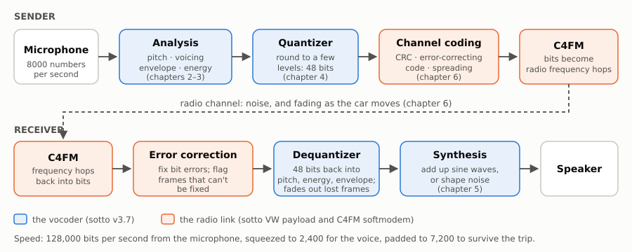

# How sotto works: a course

**sotto** is an open-source *vocoder*: a program that turns your voice into a tiny stream of numbers, small enough to send over a radio, and then turns those numbers back into a voice at the other end. This course explains every piece of it, one chapter at a time.

It is written for a high-school student (about 10th grade). You need:

- a little algebra (graphs, powers of 2),
- the idea of a sine wave (we review it),
- curiosity about how your phone or a ham radio can squeeze a voice into almost nothing.

Every picture in the course is drawn from real recordings and from the real sotto code. Nothing is a cartoon.



## Chapters

1. [Sound, numbers and the 2,400-bit budget](01-sound-and-bits.md): what a vocoder is and why we need one.
2. [Pitch and voicing](02-pitch-and-voicing.md): the buzz of your vocal cords, and the hiss of an "s".
3. [The spectral envelope](03-envelope.md): the shape of your mouth, and sotto's 20-point mel envelope.
4. [Quantization: fitting it into 48 bits](04-quantization.md): rounding, steps, and the vector quantizer for the shape.
5. [Synthesis: rebuilding the voice](05-synthesis.md): adding up sine waves, mixed voicing, and seven listening demos.
6. [Across the radio](06-radio.md): C4FM, error-correcting codes, fading, spreading and hiding lost frames.
7. [How we measure "better"](07-measuring.md): PESQ, oracles, the quantization ladder and listening tests.
8. [The hiss band: s, sh and whispers](08-hiss-band.md): sotto v3.8's 4,000 to 8,000 Hz hiss, the spare bits it hides in, and what the team learned building it.
9. [Glossary](glossary.md): every term used in the code and the design notes, in plain words.

Each chapter ends with **Try it** questions. Answers to the number questions are at the bottom of each chapter.

## A note on what's real

sotto is a research project and it is changing quickly. This course describes sotto as it is in November 2026, from the design notes [`docs/encoder-v0.md`](../encoder-v0.md) and [`docs/encoder-v1.md`](../encoder-v1.md) (which covers v1 through v3.7). sotto started as a Python prototype built on [Codec 2](https://github.com/drowe67/codec2), an older open-source vocoder, and borrows its analysis and synthesizer. sotto's own parts are a pitch and voicing tracker (chapter 2), mixed voicing (chapters 2 and 5), the 20-point envelope and its trained vector quantizer (chapters 3 and 4), and concealment of lost frames (chapter 6). It has been tested in simulation and by ear in a radio club's listening rounds, not yet on the air.

Chapters 1 to 7 now describe **v3.7**. v3.6 shrank the codebook for the radio's chip (chapter 4), and v3.7 gave the pitch tracker one more candidate, a third of Codec 2's estimate, which fixed some high-pitched pops (chapter 2). The scores in chapters 5 to 7 were measured on v3.5, which has the same decoder except for the codebook, and they say so. **v3.8** (November 2026) added the 4,000 to 8,000 Hz hiss band, which has its own chapter (chapter 8, from [`docs/unvoiced-hiss.md`](../unvoiced-hiss.md)). All of them keep the same 48-bit, 20 ms frame. There is now also a C version of sotto, in floating point and in fixed point for the radio's DSP chip ([`docs/c-port.md`](../c-port.md)). And there are lower-rate cousins for other radios, sotto 1200, 600 and 400 ([`docs/sotto-1200.md`](../sotto-1200.md), [`docs/sotto-vlr.md`](../sotto-vlr.md)), which this course doesn't cover.

## Rebuilding the figures

```sh
./tools/build_codec2.sh            # builds c2sim, c2enc, c2dec
make -C c                          # the v3.8 C tools, for chapter 8's figure and clips
python tools/course_figures.py     # rewrites docs/course/figures/*.svg and docs/course/audio/*.flac
```

The script reads the clips in `docs/samples/` and the results in `docs/results/`. `python tools/course_figures.py --hiss-only` remakes just chapter 8's figure and clips.
