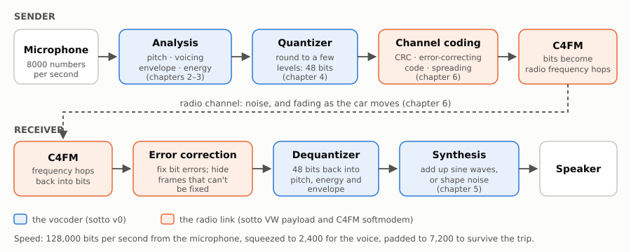

# How sotto works: a course

**sotto** is an open-source *vocoder*: a program that turns your voice into a tiny stream of numbers, small enough to send over a radio, and then turns those numbers back into a voice at the other end. This course explains every piece of it, one chapter at a time.

It is written for a high-school student (about 10th grade). You need:

- a little algebra (graphs, powers of 2),
- the idea of a sine wave (we review it),
- curiosity about how your phone or a ham radio can squeeze a voice into almost nothing.

Every picture in the course is drawn from real recordings and from the real sotto code. Nothing is a cartoon.



## Chapters

1. [Sound, numbers and the 2,400-bit budget](01-sound-and-bits.md): what a vocoder is and why we need one.
2. [Pitch and voicing](02-pitch-and-voicing.md): the buzz of your vocal cords, and the hiss of an "s".
3. [The spectral envelope](03-envelope.md): the shape of your mouth, and sotto's 20-point mel envelope.
4. [Quantization: fitting it into 48 bits](04-quantization.md): rounding, steps, bit budgets and the shape quantizer.
5. [Synthesis: rebuilding the voice](05-synthesis.md): adding up sine waves, and the six listening demos.
6. [Across the radio](06-radio.md): C4FM, error-correcting codes, fading and spreading.
7. [How we measure "better"](07-measuring.md): PESQ, oracles and the quantization ladder.
8. [Glossary](glossary.md): every term used in the code and the design notes, in plain words.

Each chapter ends with **Try it** questions. Answers to the number questions are at the bottom of each chapter.

## A note on what's real

sotto is a research project and it is changing quickly. This course describes **sotto v0**, the first version of the encoder (October 2026), as described in [`docs/encoder-v0.md`](../encoder-v0.md). Right now v0 is a Python prototype that borrows its pitch tracker, voicing detector and synthesizer from [Codec 2](https://github.com/drowe67/codec2), an older open-source vocoder. Its new part is how it describes and packs the shape of the voice (chapters 3 and 4). Everything has been tested in simulation, not yet on the air.

## Rebuilding the figures

```sh
./tools/build_codec2.sh            # builds c2sim, c2enc, c2dec
python tools/course_figures.py     # rewrites docs/course/figures/*.svg and docs/course/audio/*.flac
```

The script reads the clips in `docs/samples/` and the results in `docs/results/`.
