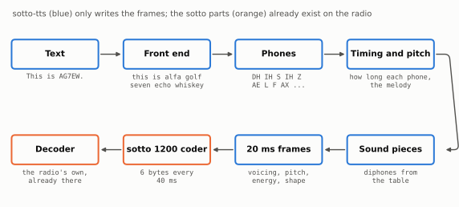

# 1. Talking in frames

[Course home](README.md) · Next: [From letters to sounds](02-letters-to-sounds.md)

## Big idea

A text-to-speech engine (TTS for short) reads text out loud. Most engines make sound directly: they glue together bits of recorded audio, or a big neural network draws the sound wave sample by sample. sotto-tts does neither. It writes the *description* of speech that the radio's sotto decoder already knows how to play. That is why it fits in a few tens of kilobytes.

## What a radio decoder expects

A digital radio doesn't send your voice as a sound wave. That would take far too many bits. Instead its **vocoder** (say *VOH-koh-der*, "voice coder") measures a few things about your voice every 20 milliseconds, sends those numbers, and the radio at the other end rebuilds a voice from them. sotto describes each 20 ms **frame** with four things:

| Field | What it means | In everyday words |
|---|---|---|
| **voicing** | Is the voice buzzing or hissing? | "aaa" buzzes, "sss" hisses |
| **pitch** | How fast the vocal cords buzz, in hertz (Hz) | high voice or low voice |
| **energy** | How loud the frame is | loud or quiet |
| **shape** | How loud each part of the spectrum is (the *spectral envelope*) | which vowel or consonant it is |

The shape is the clever part. Your mouth and tongue act like a filter that makes some frequencies louder than others. An "ee" has a different filter from an "oo", even at the same pitch. sotto sends the shape as a few entry numbers, each picking one entry from a **codebook**: a list of shapes learned from real voices. Adding the picked entries together gives the frame's shape. Sending a few entry numbers takes far fewer bits than sending the shape itself.

**sotto 1200** packs two frames into one **superframe** of 48 bits every 40 ms. That is 6 bytes, and 1,200 bits every second. For comparison, a phone call uses about 64,000 bits per second, and a CD about 1,400,000.

## The trick

If the decoder only needs voicing, pitch, energy and shape for every 20 ms, then a text-to-speech engine only has to *write those numbers*. It never has to make a sound wave. And it can split the job in two:

- **What is said** (which sounds, in which order) decides voicing, energy and shape. These come from a table of recorded speech pieces.
- **How it is said** (how long each sound lasts, and the melody) decides timing and pitch. These come from rules.

So the table holds **no pitch at all**. That makes it small, and it means the engine can raise its voice for a question, or slow down, without touching the table.

The chapters follow this picture:

1. The **front end** turns text into words: "AG7EW" becomes "alfa golf seven echo whiskey" (chapter 2).
2. Each word becomes **phones**, the separate sounds of speech (chapter 2).
3. Each phone gets a **time slot**, and the sentence gets a **melody** (chapter 5).
4. The engine fetches the right **sound pieces** from its table (chapters 3 and 4).
5. It turns everything into **20 ms frames** (chapter 6).
6. The **sotto 1200 coder** packs the frames into superframes. The radio's **decoder** plays them. Both of those already exist.

## How small?

sotto-tts has two tables:

| | Robot table | Diphone table |
|---|---:|---:|
| What it stores | 3 frames for each of 41 sounds | 1,634 sound pairs, about 4 frames each |
| Size | **493 bytes** | **37 KB** |
| How it sounds | clearly a robot | a person, a little rough |

<audio controls preload="none" src="audio/robot.flac"></audio> [robot.flac](audio/robot.flac): the robot table.
<audio controls preload="none" src="audio/diphone.flac"></audio> [diphone.flac](audio/diphone.flac): the diphone table.

Both say "The birch canoe slid on the smooth planks." 493 bytes is less than this paragraph takes on disk. 37 KB is about the size of 250 seconds of recorded sotto 1200 speech, so for a fixed handful of messages a recording would be smaller. The engine wins when the text can be *anything*: callsigns, frequencies, times, battery voltages, messages.

## Where does the voice come from?

To build its tables, sotto-tts needed someone to read about two hours of speech, with every sound marked to the millisecond. A person can't do the marking by hand, so the reader is **Kokoro**, an open neural text-to-speech model. Kokoro is far too big to run on a handheld radio (hundreds of megabytes, and a fast computer), but it can be the *teacher*. Its voice "af_sarah" read 2,052 sentences and word lists, and sotto-tts kept just the pieces it needed. Chapter 3 tells how.

<audio controls preload="none" src="audio/kokoro.flac"></audio> [kokoro.flac](audio/kokoro.flac): Kokoro af_sarah reading the same sentence.
<audio controls preload="none" src="audio/kokoro_sotto.flac"></audio> [kokoro_sotto.flac](audio/kokoro_sotto.flac): the same, through sotto 1200. This is the best sotto-tts could ever sound, because its pieces were cut from Kokoro *after* this step.

## Try it

1. sotto 1200 sends 6 bytes every 40 ms. How many bytes is a 5-second message? How many bits per second?
2. The diphone table is 37 KB. At 150 bytes per second, how many seconds of recorded sotto 1200 speech would fit in the same space?
3. Why is it useful that the table stores no pitch? Give two things the engine can do because of it.
4. Hum a note, then say "ahh" and "ooo" on that same note. Which of the four fields (voicing, pitch, energy, shape) changed between "ahh" and "ooo"?

## Where this is in the code

- `tts/synth.py`: `synth_params()` runs the whole engine and returns the frames; `encode()` packs them with the sotto 1200 coder.
- `c/tts/sotto_tts.c`: the same engine in C, for the radio and the web page.
- `sim/sotto_lr.py`: `Sotto1200`, the sotto 1200 coder.

Answers

1. 5 s is 125 lots of 40 ms, so 125 × 6 = 750 bytes. 6 bytes × 8 bits ÷ 0.04 s = 1,200 bits per second.
2. 37,000 ÷ 150 ≈ 247 seconds, about four minutes.
3. Pitch comes from rules, so the engine can (a) make the voice go up at the end of a question and down at the end of a statement, (b) make the whole voice higher or lower, and (c) speak faster or slower, all with the same table.
4. Only the shape. Pitch stayed the same (same note), voicing stayed "buzzing", and the loudness can stay the same. The mouth shape is what tells "ahh" from "ooo".

