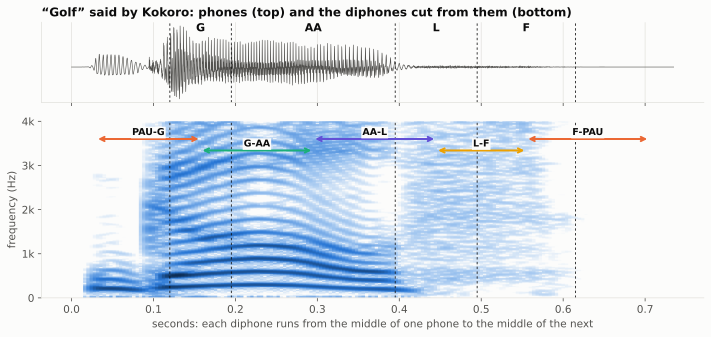
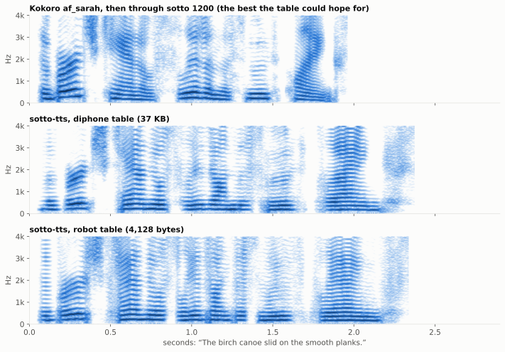

# 3. Sounds in pairs: diphones

Previous: [From letters to sounds](02-letters-to-sounds.md) · [Course home](README.md) · Next: [Choosing the best pieces](04-choosing-pieces.md)

## Big idea

You might think a speech engine could store one recording of each phone and play them in a row. It sounds terrible. Phones aren't beads on a string: each one melts into the next. The fix is to store sounds **in pairs**, cut from the middle of one phone to the middle of the next. The tricky part, the change from one sound to another, is then always a real recording.

## Why single sounds don't work

Say "golf" slowly and feel your tongue. It doesn't jump from G to AA to L to F. It *slides*. The AA after a G starts differently from the AA after a B, and the end of the AA already bends towards the L. Speech scientists call this **coarticulation** (say *koh-ar-TIK-yoo-LAY-shun*): every sound is coloured by its neighbours.

So where should we cut speech into pieces? The steadiest part of a sound is its **middle**. The edges, where one sound turns into the next, change fastest, and those are exactly the parts we can't fake. So we cut in the middles, and keep each edge whole.

## Diphones

A **diphone** (say *DY-fone*, "two sounds") is the stretch of speech from the middle of one phone to the middle of the next. The word "golf" (`G AA L F`, with a pause before and after) is five diphones:

The top of the picture is the sound wave, with dashed lines where Kokoro says each phone begins and ends. The bottom is a **spectrogram**: time goes across, frequency goes up, and darker means louder. The thin stripes in the AA are its **harmonics**, the buzz of the voice. The F is a cloud of hiss with no stripes.

Each arrow is one diphone: PAU-G, G-AA, AA-L, L-F, F-PAU. Notice how much happens inside G-AA: the stripes bend as the mouth opens. That bend is stored as it was recorded.

To say a word, the engine strings the diphones together. The joins fall in the middles of phones, where the sound is steadiest, so they are easier to hide.

## How many pairs?

With 41 phones plus the pause, there could be 42 × 42 = 1,764 pairs. Some never happen in English, even across a gap between words. sotto-tts's table has **1,634** pairs, each about 4 frames (80 ms) long.

## Where the pieces come from: a speaking teacher

To cut 1,634 pairs, you need a recording that contains every one, with every phone's start and end marked. Marking two hours of speech by hand would take weeks.

sotto-tts uses **Kokoro**, an open neural speech model, as its teacher. Two things make it perfect for the job:

1. **You can give it phones instead of text.** sotto-tts feeds Kokoro the phones its own front end makes, so the recording matches the engine's idea of each word exactly.
2. **It knows its own timing.** Inside Kokoro, one part of the network decides how long each phone should last. By changing one connection in the model file, sotto-tts made Kokoro report those durations alongside the audio. So every phone's start and end comes for free, with no guessing. (There is a fixed delay to correct: Kokoro's audio runs 50 ms ahead of its durations.)

### Choosing what Kokoro reads

Reading word lists sounds stiff (everything comes out with "list intonation"), so the corpus starts with real sentences. The engine had a pool of 13,524 short sentences from the World English Bible, a free modern translation. It picked them **greedily**, one at a time, always taking the sentence that added the most new pairs for its length, until no sentence added enough. That gave **1,665 sentences**. Then word lists filled the pairs that still had fewer than 6 examples. In all, Kokoro's voice "af_sarah" read **2,052 recordings, 122 minutes**.

(The book of Luke was left out on purpose, so that it could be a fair listening test later: the engine never heard any of it.)

### From recording to frames

Each recording goes through sotto's own **analysis**, the same measuring step a radio does on your voice. That turns it into frames: voicing, energy and shape every 20 ms (the pitch is measured too, but thrown away for the table). Then, for each pair, the engine knows exactly which frames lie between the middle of the first phone and the middle of the second.

One more fix: Kokoro gives the silence after a word to the last phone, so a final F can seem to last 240 ms. The build trims each phone next to a pause to where its loudness is within 20 dB of its peak. (In the "golf" picture, F has been trimmed this way.)

## The robot table

The small table takes the opposite approach. For each of the 41 phones it keeps just **4 frames**, spread evenly through the sound. Each one is the **average** over every example of that phone in the whole corpus. Averaging was much better than picking the single most typical example: a speech recogniser's word error fell from 80% to 51%.

The first version stopped there, at 493 bytes, and it had no coarticulation at all. The second version adds a little. The phones are sorted into 8 rough families (front vowels, back vowels, open vowels, lip sounds, tongue-tip sounds, hushing sounds, back-of-mouth sounds, and silence). For each phone, the table keeps an extra **start frame** for each family that can come before it, averaged over just those examples, and an extra **end frame** for each family that can come after it. So the start of the M in "me" is a different frame from the start of the M in "am". The engine picks the start and end frames that fit the neighbours and draws straight lines between all the frames. That makes the table 4.1 KB, and it halved the recogniser's mistakes on the hard Harvard sentences (42% to 22%). It still sounds like a robot, because one family-average frame is a rough guess at a real glide.

Compare the three spectrograms. The diphone table (middle) has the same bending stripes as Kokoro (top), though the timing differs, because the engine uses its own rules for how long each sound lasts (chapter 5). The robot table (bottom) has straighter, blockier stripes: every glide is a straight line from one averaged frame to the next.

## Try it

1. Write out the diphones of "fish" (`F IH SH`), with a pause before and after. How many are there?
2. A word with *n* phones, with a pause before and after, needs how many diphones?
3. Why cut at the middles of phones instead of at their edges?
4. The corpus has 6 examples of most pairs. Why have more than one? (Chapter 4 answers this properly.)

## Where this is in the code

- `tools/tts_corpus.py`: `Kokoro.say()` (phones in, audio and timings out), `--sentences` (the greedy sentence choice), `--reanalyse` (redo the analysis from stored audio).
- `tools/tts_build.py`: `diphone_table()` and `robot_table()` build the tables.
- `tts/table.py`: the table file format; `tts/synth.py`: `find_unit()` fetches a pair.

Answers

1. PAU-F, F-IH, IH-SH, SH-PAU: four diphones.
2. *n* phones plus two pauses is *n* + 2 sounds, which have *n* + 1 neighbouring pairs.
3. The middle of a phone is its steadiest part, so a join there is easy to smooth over. The edges are where the sound changes fastest; that change is hard to fake, so it should come from a real recording.
4. Different examples of the same pair differ (faster, slower, stressed, unstressed, a cough nearby). Having several lets the engine choose the one that fits best with its neighbours, and skip bad ones.

