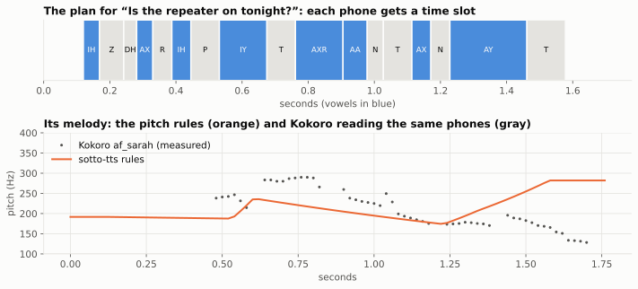

# 5. Rhythm and melody

Previous: [Choosing the best pieces](04-choosing-pieces.md) · [Course home](README.md) · Next: [Building the frames](06-building-frames.md)

## Big idea

The same words can be said in many ways. "You're going." is a statement; "You're going?" is a question. The difference is **prosody** (say *PROSS-uh-dee*): the rhythm (how long each sound lasts, and where the pauses go) and the melody (where the pitch goes up and down). sotto-tts's table holds no pitch and no timing, so all of it comes from a few simple rules.

## Rhythm: how long is each sound?

Every phone starts from its **typical length**: the middle value (median) of all its examples in the corpus, with one value for stressed vowels and one for unstressed. A stressed AA lasts longer than the quick AX in "about". Then a few adjustments:

- Everything is 15% slower than the corpus, because a radio message should be easy to follow.
- **Function words** ("the", "of", "is") are 0.85 times as long: we rush through them.
- The **last syllable of a phrase** is 1.35 times as long. Listen to yourself: you slow down at the end of a sentence. This "phrase-final lengthening" is one of the clues your ear uses to hear where a sentence ends.
- **Pauses**: 0.22 s at a comma, 0.4 s between sentences, and 0.2 s between the words of a callsign.

The top of this picture is the time plan for a question. Each box is one phone, as long as the rules make it; the vowels are blue.

## Melody: where does the pitch go?

Your voice has a comfortable middle pitch. For the af_sarah voice it is about **188 Hz**. The melody rules move around that middle:

1. **A falling baseline.** Over each phrase, the pitch slowly drifts down by 15%. Speakers do this naturally, partly because they run low on breath. It's called **declination** (say *dek-li-NAY-shun*).
2. **A peak on each important word.** The stressed vowel of each content word (nouns, verbs, adjectives, as opposed to function words) gets a rise, up to about 1.3 times the middle pitch. Each peak is a little lower than the one before.
3. **An ending.** A statement falls to about 0.76 times the middle. A phrase ending in a comma rises a little, to show there's more to come. A **yes/no question** (one starting with a word like "is", "are", "can", "do") rises to 1.5 times the middle at the end.

The orange line in the bottom half of the picture is the result for "Is the repeater on tonight?". You can see the small peak on "repeater", the slow fall, and the rise at the end for the question.

The gray dots are Kokoro reading the same phones, with the pitch measured by a pitch tracker. Kokoro has bigger, livelier peaks, and its timing is different (it starts later and moves faster). And notice something surprising: **Kokoro doesn't rise at the end of the question.** Kokoro read all 49 yes/no questions in the corpus nearly level, so the question rise in sotto-tts is a rule on purpose, not something it learned.

<audio controls preload="none" src="audio/question.flac"></audio> [question.flac](audio/question.flac): sotto-tts asking "Is the repeater on tonight?".

## Does melody matter?

Here is the same sentence with the rules, and with the pitch held flat at the middle value:

<audio controls preload="none" src="audio/diphone.flac"></audio> [diphone.flac](audio/diphone.flac): with the melody rules.
<audio controls preload="none" src="audio/flat.flac"></audio> [flat.flac](audio/flat.flac): pitch held flat.

The flat version is still understandable, but it's harder work, and it sounds like a machine. A speech recogniser agrees: on a test set, flat pitch gave 46% word error against 33% with the rules (measured on an earlier table). Melody helps your brain split speech into words and find the important ones.

## Rules or learning?

sotto-tts also has a second way to do prosody: two small **decision trees** (3.6 KB together) learned from Kokoro reading the Gospel of John and part of Acts (172 minutes). A decision tree is a chain of yes/no questions: "Is this phone a vowel? Is it stressed? Is it the last syllable in the phrase?" Each answer leads to another question, until the last one gives a prediction, such as "this phone lasts 85 ms". One tree predicts how long each phone lasts, from 28 facts about it; the other predicts three pitch points in each vowel.

The trees predict Kokoro's timing and pitch more closely than the rules do. But when the project lead listened to both reading Luke chapter 2, they preferred the **rules**. The recogniser scored the two the same. So the rules are the default, and the trees are an option (the "Trained" button on the [demo page](../tts.html)). This happened more than once in the project: the final judge is a human ear, not a score.

## Try it

1. The stressed vowel AA lasts 120 ms in the corpus. How long will it be in sotto-tts: (a) in the middle of a phrase, (b) in the last syllable of a phrase?
2. The middle pitch is 188 Hz. What pitch does a statement end on? A yes/no question?
3. Say "You're going." and "You're going?" out loud. Draw the pitch of each as a line. Where do they differ?
4. Why might a recogniser find speech with no melody harder to understand?

## Where this is in the code

- `tts/synth.py`: `phone_plan()` (the rhythm rules and pauses) and `f0_track()` (the melody rules).
- `tts/prosody.py` and `tools/tts_prosody.py`: the decision trees and how they were trained; `tts/data/prosody.bin` stores them.

Answers

1. (a) 120 × 1.15 = 138 ms. (b) 138 × 1.35 ≈ 186 ms.
2. A statement ends near 0.76 × 188 ≈ 143 Hz. A yes/no question ends near 1.5 × 188 = 282 Hz.
3. They are the same until the last word. The statement falls at the end; the question rises.
4. Melody and rhythm mark where phrases end and which words matter. Without them, all the words run together with the same weight, and the recogniser (or a person) has fewer clues to separate them.

