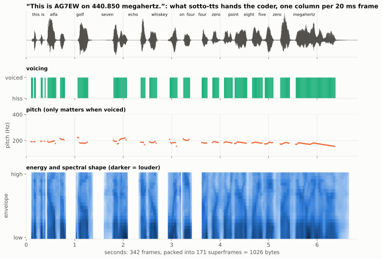

# 6. Building the frames

Previous: [Rhythm and melody](05-rhythm-and-melody.md) · [Course home](README.md) · Next: [Hunting for rough patches](07-hunting.md)

## Big idea

By now the engine has a plan (each phone's time slot), a melody, and a table of pieces. This chapter puts them together into one column of numbers every 20 ms: voicing, pitch, energy and shape. Then the sotto 1200 coder packs the columns into superframes. Callsigns get special treatment: they are spoken with whole recorded words instead of pieces.

## Stretching pieces to fit

A diphone in the table was recorded at Kokoro's speed, but the plan has its own timing. So the engine **stretches or squeezes** each piece to fit.

A diphone has two halves: the second half of its first phone and the first half of its second phone. The table stored where each frame sat inside its half: say at 25%, 50% and 75% of the way through. The engine puts each frame at the same fraction of the way through the *planned* half. That way a quick change near the start of a half stays near the start, even if the half is now twice as long.

These placed frames are called **keyframes**, like the key drawings in an animation. Between them, the engine fills in every 20 ms frame by **interpolation**: drawing a straight line from one keyframe's value to the next, and reading off the value at each frame's time.

## Smoothing the joins

Two diphones meet in the middle of each phone. Even with the careful choices of chapter 4, the shapes on either side of a join don't match exactly. A sudden jump in shape sounds like a click or a little "blip".

So the engine moves both sides towards each other: each side goes a quarter of the way, which halves the gap. The movement is biggest right at the join and fades to nothing at the edges of the phone. The same is done for loudness. The mismatch is still there, but spread out over the whole phone, where the ear hardly notices it.

## Pitch and the coder

The melody from chapter 5 gives a pitch for every frame. It only matters in voiced frames; hiss has no pitch.

Then each frame's shape has to be turned into codebook numbers. The interpolated shapes are in-between shapes that aren't in the codebook, so the engine **searches** the codebook for the closest entry, exactly as sotto's coder does with a real voice. Finally, pairs of frames are packed into 48-bit superframes.

Here is everything the engine produced for one sentence:

- The **sound wave** at the top is what the radio's decoder plays back.
- **Voicing**: green for buzz. The gaps are hiss (S, F, SH, the H in "whiskey") and silence.
- **Pitch**: only drawn where the frame is voiced. It stays near 188 Hz with small peaks; the callsign words keep their own pitch (next section).
- **Energy and shape**: each column is one frame's spectral envelope, low frequencies at the bottom. Darker means louder. You can see vowels as dark low bands and hiss as lighter high bands.

The whole sentence is 342 frames, 171 superframes, **1,026 bytes**. A WAV file of the same speech at telephone quality would be about 55,000 bytes.

## Callsigns: whole words

The first tables built callsigns from diphones like every other word. A speech recogniser got 40% of the callsign words wrong: "golf" came out as "gulf", and short words like "echo" ran together. Callsigns are the one thing a radio *must* get right.

So there is a third, small table: **37 whole words** (the 26 NATO words, the 10 digits, and "stroke"), together only **5 KB**. To record each one, Kokoro read it in a little carrier phrase, "kilo. WORD, papa.", slowly. A word said on its own came out with odd starts, and a word in a list came out naturally. The engine cut the word out at the quietest frame near each end, and kept **its own pitch**, so each callsign word has the natural melody Kokoro gave it.

When the plan meets a callsign element, it stretches that slot to the word's real length and drops the recorded word in, with silence on both sides.

<audio controls preload="none" src="audio/callsign_diphones.flac"></audio> [callsign_diphones.flac](audio/callsign_diphones.flac): the callsign built from diphones.
<audio controls preload="none" src="audio/callsign_words.flac"></audio> [callsign_words.flac](audio/callsign_words.flac): with whole callsign words.

With whole words, the recogniser's callsign word error fell from 40% to about 18%. Most of what's left is the ordinary words around the callsign.

### A pitch slip in "foxtrot"

Keeping each word's own pitch went wrong once. A listener heard "foxtrot" drop an **octave** (to half the pitch) on its last syllable. Kokoro had ended the word in **creak**, the crackly low voice many people use at the end of a phrase (also called *vocal fry*). sotto's pitch tracker read the creak as half the true pitch.

Two fixes followed. The word builder got a guard: a frame whose pitch is more than 1.4 times away from the word's typical pitch is pulled back into range. And the pitch tracker itself was improved in sotto's main code, so that it holds the last clear pitch through word-final creak. After that fix, the guard in "foxtrot" no longer needs to do anything.

## On the radio and in your browser

The whole engine also exists in C (about 1,400 lines), so that it can run on small devices. It calls the radio's own fixed-point sotto 1200 coder, so the superframes are exactly what a radio would send. A test program checks that the C version and the Python version make the same frames.

The same C code, compiled to **WebAssembly** (a way to run C inside a web page), powers the [demo page](../tts.html): 219 KB for the code, all three tables, the rules, the exceptions list and sotto's coder and decoder.

## Try it

1. A diphone's second half had keyframes at 25%, 50% and 75% of a 60 ms half. The plan makes that half 90 ms. At what times (from the start of the half) do the keyframes go now?
2. Two diphones meet with shapes that differ by 8 units. After smoothing, how big is the gap at the join?
3. 1,026 bytes for 6.8 seconds of speech: how many bytes per second is that? Check it against 1,200 bits per second.
4. Why record the callsign words inside "kilo. WORD, papa." instead of on their own?

## Where this is in the code

- `tts/synth.py`: `keyframes_diphone()` (placing and smoothing), `keyframes_robot()`, `render()` (interpolation), `fit_words()` and `splice_words()` (callsign words), `encode()` (the coder).
- `tools/tts_words.py`: records and cuts the callsign words; `hold_pitch()` is the octave guard.
- `c/tts/sotto_tts.c` and `tools/tts_ccheck.py`: the C engine and the check that it matches Python.

Answers

1. The same fractions of 90 ms: 22.5 ms, 45 ms and 67.5 ms.
2. Each side moves a quarter of 8 = 2 units towards the other, so the gap is 8 − 2 − 2 = 4 units: half what it was.
3. 1,026 ÷ 6.8 ≈ 151 bytes per second, and 151 × 8 ≈ 1,207 bits per second. That's 1,200 bit/s (the sentence was rounded up to a whole superframe).
4. Said alone, Kokoro's words started oddly (strange voiced onsets). In a short list, each word is said naturally, and the full stop after "kilo" makes a clean silence before the word, so it can be cut out neatly.

