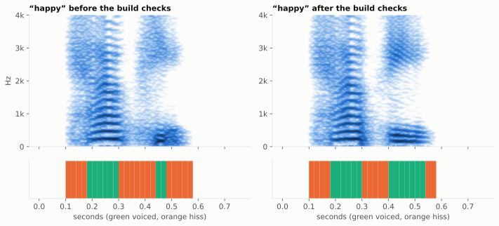
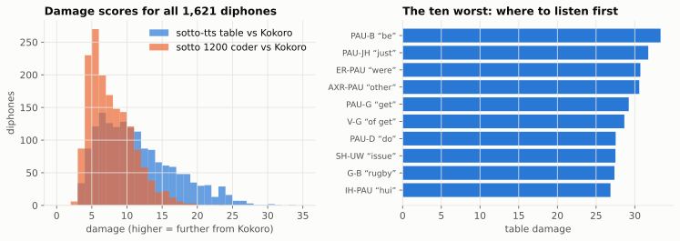

# 7. Hunting for rough patches

Previous: [Building the frames](06-building-frames.md) · [Course home](README.md) · Next: [Glossary](glossary.md)

## Big idea

How do you know if a speech engine is any good, and where it goes wrong? Two ways: let a machine listen (a speech recogniser counts how many words it gets wrong), and listen yourself. The machine is quick and never gets bored, but people hear things it doesn't. sotto-tts was improved by a hunt that used both: listen to every diphone, mark the nasty ones, trace each one back to where it came from, and fix the cause.

## Measuring with a machine

A **speech recogniser** turns speech into text, like the dictation on a phone. sotto-tts is tested with an open recogniser called Parakeet. The engine reads a set of sentences, the recogniser writes down what it heard, and we count the mistakes. The **word error rate** (WER) is:

> WER = (words left out + words added + words changed) ÷ words in the sentence

So if the engine says "the birch canoe slid on the smooth planks" (8 words) and the recogniser hears "the bird canoe slid on smooth planks", it changed one word and left out one: WER = 2 ÷ 8 = 25%.

| Word error | Harvard sentences | everyday sentences | radio phrases | callsigns |
|---|---:|---:|---:|---:|
| Kokoro af_sarah through sotto 1200 | 4.6% | 0.5% | 0.0% | 12.2% |
| **sotto-tts, diphone table** | **16.7%** | **7.7%** | **0.0%** | **17.6%** |
| sotto-tts, robot table (4.1 KB) | 21.7% | 16.7% | 9.5% | 17.6% |
| sotto-tts, first robot table (493 bytes) | 41.7% | 39.8% | 35.7% | 28.4% |

The **Harvard sentences** are a famous test set from the 1960s ("The birch canoe slid on the smooth planks"), written so that you can't guess words from the meaning. They are hard on purpose. Everyday and radio phrases are easier because the words are predictable.

Even Kokoro's own voice gets 12% of callsign words wrong, because "Alfa Golf Seven Echo Whiskey" makes no sense as English, and the recogniser keeps trying to turn it into English.

## Where is the loss?

An experiment showed where sotto-tts loses most. Start from Kokoro's own sotto frames (4.6% WER on Harvard) and replace just one of them with the engine's own:

| Replace Kokoro's... | with the engine's | WER |
|---|---|---:|
| nothing | | 4.6% |
| voicing | | 7.1% |
| energy | | 8.8% |
| **shapes** | | **35%** |

(This was measured on an early table; the shapes have improved since, but they are still the biggest loss.) So the *shapes* are what matter. That's where the hunt looked.

## Listening to everything

A recogniser score is one number for a whole test set. It can't tell you that the T in "put" sounds smeared. For that, you need ears.

The first hunt was done by hand. The whole diphone table was played back to back, 1,634 pairs, about 9 minutes, with a one-second pause every five seconds so that a listener could write down time indexes: "something nasty around 0:13 and 4:08". Each time index pointed at 10 to 20 pairs. The engine then said real words containing those pairs, and in real words the bad ones stood out clearly: "happy", "put", "tube", "ruin", "fluid", "January". Each one was traced back to the recording it had been cut from, and that showed the causes in chapter 4: a vowel analysed as hiss, a stop with no silence, a piece cut across two words.

Here is "happy" before and after the fault checks were added to the build:

The strip under each spectrogram shows the voicing of each 20 ms frame: green for buzz, orange for hiss. Before (left), most of the final vowel IY is marked as hiss, and its harmonic stripes are smeared. After (right), it is voiced, with clear stripes.

<audio controls preload="none" src="audio/happy_before.flac"></audio> [happy_before.flac](audio/happy_before.flac): before.
<audio controls preload="none" src="audio/happy_after.flac"></audio> [happy_after.flac](audio/happy_after.flac): after.

## The diphone hunt bench

That process worked so well that it became a tool: the **diphone hunt bench**. For every pair in the table, it finds a common English word containing that pair and makes four versions:

1. **Reference**: Kokoro says the word.
2. **Reference encoder**: the reference through sotto 1200.
3. **Radio encoder**: the reference through the small encoder that runs on the UV-K6 handheld.
4. **TTS**: sotto-tts says the same word from its table.

Comparing 1 with 2 or 3 shows what the *encoder* does to that sound. Comparing 2 with 4 shows what the *table* does. Each pair gets a damage score: how far the shapes are apart, how much the loudness jumps, and how often the voicing disagrees, over the stretch of the pair.

The left graph shows that the table (blue) does more damage than the encoder (orange): most table scores sit between 5 and 15, with a long tail up to 33. The tail is where to listen first, and the right graph lists the ten worst. Many of them are pairs with a pause, at the very start or end of a word (PAU-B in "be", ER-PAU in "were"). Kokoro says a single word slowly and carefully, but sotto-tts cuts its starts and ends from running speech, so these scores partly measure the difference in style. That's why the score only says *where to listen*, and the listener decides.

The bench page lets a listener step through the pairs with the keyboard, play any version, and mark each one Bad or Fine with a note. The marks are saved, so the next round of fixing starts from a list.

### A test for encoder changes

The reference words never change, so the bench is also a fixed test for sotto's encoder. When sotto's pitch tracker was improved, the bench ran all 1,621 words through the old and the new encoder. The number of frames where the measured pitch was more than 1.4 times off the true pitch fell from **68 to 32**, and almost nothing else moved. A follow-up change left 1,619 of the 1,621 words *byte for byte* the same. That's a quick, precise way to check that a fix fixes what it should and breaks nothing else.

## What we learned

- **Listen to the whole space.** Playing every diphone found faults no test sentence happened to contain.
- **Real words show faults clearly.** A bad pair is easy to miss in a list of pairs and easy to hear in "happy".
- **Fix causes.** Each fault became a rule in the build, so every pair with the same fault improved, including ones nobody had heard yet.
- **Scores point; ears decide.** The recogniser and the damage scores are good at saying where to look. Choices like "rules or trees" and "is this better?" were made by listening.

## Try it

1. The engine says "the quick brown fox" and the recogniser hears "a quick brown box". What is the WER?
2. Why does Kokoro's own voice get 12% of callsign words wrong, but 0% of radio phrases?
3. The table damage is much higher than the codec damage. What does that tell you about where to spend effort?
4. Pick a word with a pair you think might be hard (try "rhythm", "twelfths" or "genre") and type it into the [demo page](../tts.html). Does it sound right? If not, which sound is wrong?

## Where this is in the code

- `tools/tts_eval.py`: the recogniser test (word error per test set).
- `tools/diphone_hunt.py`: makes the bench's words, clips and scores; `docs/diphone-hunt.html` is the bench page, and `docs/diphone-hunt.md` describes the hunt.
- `tools/tts_build.py`: `checks()`, the fault checks that came out of the hunt.

Answers

1. Two words changed ("the" to "a", "fox" to "box") out of 4: WER = 2 ÷ 4 = 50%.
2. Radio phrases are normal English, so the recogniser's guesses about likely words help it. A string of NATO words isn't normal English, so its guesses work against it.
3. The table loses more than the encoder does, so improving the table (better pieces, better joins) will help more than improving the encoder, at least for sotto-tts.
4. There's no single answer. "Twelfths" (`T W EH L F TH S`) has a very rare cluster of consonants, so its pairs have few examples to choose from.

