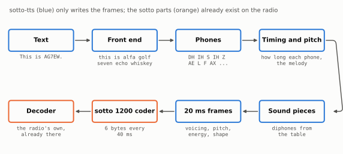

# How sotto-tts talks: a course

**sotto-tts** is a tiny text-to-speech engine. You type "This is AG7EW on 440.850 megahertz", and a radio speaks it. The radio already has a **sotto** decoder, the program that turns a stream of numbers back into a voice, so sotto-tts never makes any sound itself. It only writes the numbers the decoder expects: 6 bytes for every 40 milliseconds of speech.

This course explains how it does that, one step at a time. You can try the engine in your browser on the [sotto-tts demo page](../tts.html).

It is written for a high-school student (about 10th grade). You need:

- a little algebra (graphs, percentages, powers of 2),
- an idea of what a sound wave and a spectrogram are (chapter 1 has a short review, and the [sotto course](../course/) explains them in depth),
- curiosity about how a computer can read out loud.

Every picture and clip in the course comes from the real engine and the real voice it was built from. The only drawing is the flow chart in chapter 1.



## Chapters

1. [Talking in frames](01-talking-in-frames.md): what a text-to-speech engine does, and the trick that makes sotto-tts small.
2. [From letters to sounds](02-letters-to-sounds.md): reading callsigns and numbers, phonemes, letter-to-sound rules and the exceptions list.
3. [Sounds in pairs: diphones](03-diphones.md): why speech is cut between the middles of sounds, and where the pieces come from.
4. [Choosing the best pieces](04-choosing-pieces.md): picking one recording of each pair so that neighbours fit together.
5. [Rhythm and melody](05-rhythm-and-melody.md): how long each sound lasts and where the voice goes up and down.
6. [Building the frames](06-building-frames.md): turning pieces and a melody into sotto frames, and why callsigns are whole words.
7. [Hunting for rough patches](07-hunting.md): listening to every diphone, measuring with a speech recogniser, and fixing causes rather than symptoms.
8. [Glossary](glossary.md): every term in the course and the code, in plain words, with pronunciations.

Each chapter ends with **Try it** questions. Answers are in a fold-out box at the bottom of each chapter.

## A note on what's real

sotto-tts was built in November 2026 as a prototype on a PC (`tts/`, `tools/tts_*.py`) with a C version that runs the same way (`c/tts/`) and a web page (`docs/tts.html`). It writes **sotto 1200** frames, the 1,200 bit-per-second version of sotto made for the small Baofeng UV-K6 handheld ([`docs/sotto-1200.md`](../sotto-1200.md)). Its voice was cut from **Kokoro** (an open neural speech model, Apache-2.0 licence) reading two hours of sentences in its voice "af_sarah". It has not been put on a radio yet. The full design notes are [`docs/sotto-tts.md`](../sotto-tts.md), and the listening bench in chapter 7 is [`docs/diphone-hunt.md`](../diphone-hunt.md).

## Rebuilding the figures

```sh
make c37                                           # the sotto 1200 decoder
python tools/tts_course_figures.py --models KOKORO_DIR \
    --old-table OLD_DIPHONE.stt --hunt HUNT.json   # docs/tts-course/figures and audio
```

`KOKORO_DIR` holds the Kokoro model files (see `docs/sotto-tts.md`). `OLD_DIPHONE.stt` is the table from before the rough-patch checks (`git show 228be5c:tts/data/diphone.stt`), and `HUNT.json` comes from `tools/diphone_hunt.py`. Without them, chapter 7's two figures are skipped.
